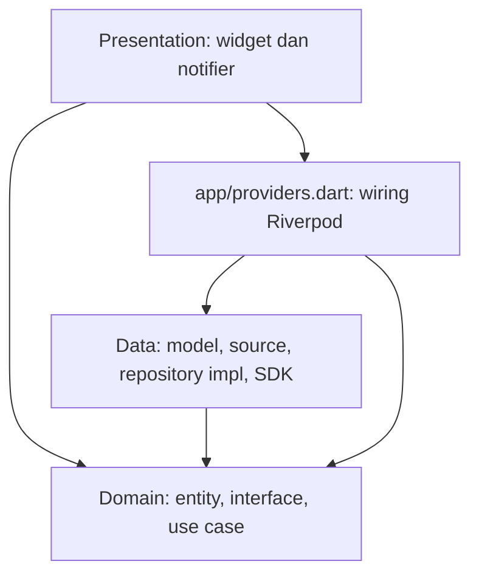

# Minggu 7: Clean Architecture

Campus Notify Minggu 6 direfactor menjadi **feature-first Clean Architecture** sesuai
[codelab Minggu 7](https://jti-polinema.github.io/flutter-codelab/07-minggu-7-clean-architecture/index.html#0).
Project, fitur, app ID, dan tampilan lama dipertahankan. Tidak membuat project Flutter baru.

## Identitas Mahasiswa

- **Nama:** Agus Prasetyo
- **NIM:** 244107020049
- **Kelas:** TI-3H
- **Mata Kuliah:** Pemrograman Mobile
- **Program Studi:** D4 Teknik Informatika, Jurusan Teknologi Informasi

## Tujuan

Memisahkan presentation, domain, dan data; menerapkan dependency inversion; serta
menguji aturan bisnis melalui repository palsu tanpa jaringan atau database.
Pengerjaan ulang dan bukti terbaru bertanggal **14 Oktober 2026**.

## Konsep SOLID dan Pilihan Struktur

| Prinsip | Penerapan pada project |
| --- | --- |
| Single Responsibility | Home menampilkan state; HTTP/storage ditangani data, validasi login oleh use case |
| Open/Closed | Sumber pengumuman dapat diganti melalui `AnnouncementDataSource` tanpa mengubah widget |
| Liskov Substitution | Fake repository memenuhi kontrak hasil sukses/failure yang sama dengan impl |
| Interface Segregation | Kontrak auth, announcements, push, dan registrasi perangkat dipisah |
| Dependency Inversion | Use case bergantung pada interface domain; implementasi diinjeksi Riverpod |

Feature-first dipilih karena aplikasi punya auth, announcements, dan push. Setiap
fitur mengelompokkan layernya sendiri. Layer-first lebih ringkas untuk satu fitur,
tetapi kontrak dan perubahan antarfitur lebih sulit ditelusuri saat aplikasi berkembang.

## Praktikum 1: Audit Project Lama

Dasar pengerjaan adalah Week 6, dengan snapshot sebelum refactor pada **`6d1b4f7`**.
Snapshot berisi salinan 80 file Week 6 yang identik. Commit tersebut menyimpan
kondisi awal; audit dan refactor ada pada hasil kerja Week 7 ini.

| File awal | Layer saat itu | Masalah dan tindakan |
| --- | --- | --- |
| `pages/home_page.dart` | Presentation + data | Membaca token, memanggil Dio, memakai `Options`, parsing response → pindahkan ke repo auth/notifier |
| `data/api_client.dart` | Data | Widget memakai client langsung → batasi akses melalui repository |
| `providers/auth_provider.dart` | State + DI + storage | Membaca/menulis token → repository/use case; pisahkan wiring dari state |
| `data/auth_repository.dart` | Entity + implementasi | Belum ada interface → pecah entity, model, source, interface, impl |
| `pages/announcement_page.dart` | Presentation + konten | Konten tertanam di widget → source/model/entity |
| `messaging/push_service.dart` | SDK + HTTP + lifecycle | Pisahkan kontrak push dan repo registrasi perangkat |
| `routes.dart` | Konstanta + parsing | Parsing rute → fungsi Dart murni di `core/format.dart` |

Tiga pencarian awal dan audit akses melalui provider disimpan di
[README project asal Minggu 6](../06-week-6-authentication-security-fcm/README.md#audit-project-lama-untuk-minggu-7-praktikum-1). Regex SDK literal dari modul tidak
menangkap `ref.read(apiClientProvider)` atau `tokenStoreProvider`, sehingga audit
juga memeriksa kedua akses itu. Tidak ditemukan formatting tanggal mentah pada
widget lama. Instansiasi `AuthRepository()` ada di wiring lama, bukan widget;
masalahnya ialah kontrak masih berupa implementasi konkret.

Pemetaan **setiap file lama** dan struktur yang dipilih tersedia di
[docs/ai_challenge.md](docs/ai_challenge.md).

## Struktur Target

```text
lib/
  core/{failures.dart,format.dart}
  app/{providers.dart,session_expiry.dart,router.dart,campus_app.dart}
  app/data/
  app/presentation/pages/home_page.dart
  features/auth/{domain,data,presentation}
  features/announcements/{domain,data,presentation}
  features/push/{domain,data,presentation}
```

Auth dan announcements akan memiliki entity, interface repository, implementasi,
use case dengan aturan bisnis, dan provider Riverpod. Domain tetap Dart murni.
Home merupakan layar gabungan fitur, sehingga berada di app presentation.

## Status Praktikum 1

Audit, tiga pencarian awal, snapshot, dan struktur target pada README project asal sudah tersedia.
Domain/data dan presentation masih source Week 6 pada tahap ini; implementasi
refactor dilakukan pada Praktikum 2 dan 3. Proposal awal disimpan dalam
[usulan awal AI](docs/ai_challenge.md#usulan-awal-ai) sebelum implementasi.

## Praktikum 2: Domain dan Data Per Fitur

| Peran | Auth | Announcements |
| --- | --- | --- |
| Entity murni | `AuthSession` | `Announcement` |
| Interface di domain | `AuthRepository` | `AnnouncementRepository` |
| Model di data | `AuthSessionModel.toEntity` | `AnnouncementModel.fromJson/toEntity` |
| Source di data | Mock auth dan secure token store | Konten contoh Week 6 |
| Implementasi di data | `AuthRepositoryImpl` | `AnnouncementRepositoryImpl` |
| Use case di domain | `Login` | `GetAnnouncement` |

`Login` memvalidasi input, menormalisasi email, lalu menyimpan sesi setelah login
berhasil. `GetAnnouncement` memvalidasi ID sebelum mengakses repository. Fetch
daftar, restore sesi, dan logout memakai repository langsung karena belum punya
aturan bisnis tambahan. Tidak membuat wrapper use case per CRUD satu baris.

Repository mengembalikan record Dart `Result<T> = ({T? value, Failure? failure})`.
Exception SDK/parsing/storage dipetakan menjadi `Failure` dengan pesan pengguna.
Mapping berada di model; entity dan domain tidak mengimpor package/framework.


Status Praktikum 2: domain/data sudah tersedia dan dipakai oleh presentation pada Praktikum 3.

## Praktikum 3: Presentation, DI, dan Verifikasi



Panah menunjukkan import/dependensi kode. Domain tidak mengetahui Flutter, Dio,
SQLite, atau Firebase. Composition root boleh mengetahui implementasi data untuk
menyuntikkan kontrak. Widget memperoleh state/provider; tidak membuat repository.

Wiring implementasi terpusat di `app/providers.dart`. Sinyal expiry di
`app/session_expiry.dart` memutus siklus wiring→notifier auth→wiring. Home berada di
app presentation karena menggabungkan tiga fitur; halaman fitur tidak saling
mengimpor presentation fitur lain. Router berada di `app/router.dart`, konstanta
rute tetap di `routes.dart`, dan `main.dart` hanya bootstrap.

```text
lib/
  main.dart
  routes.dart
  core/{failures.dart,format.dart}       # Dart murni
  app/
    providers.dart                     # DI implementasi
    session_expiry.dart                # Bridge callback sesi
    router.dart
    campus_app.dart
    data/                              # Integrasi HTTP lintas fitur
    presentation/pages/home_page.dart
  features/
    auth/{domain,data,presentation}
    announcements/{domain,data,presentation}
    push/{domain,data,presentation}
test/
docs/
screenshots/
```

### Hasil Tiga Pencarian Sterilitas

Dari folder Week 7; `lib/pages` lama sudah dipindahkan.

```bash
rg 'Dio\(|http\.|openDatabase|getDatabasesPath|FlutterSecureStorage|SharedPreferences\.getInstance|jsonDecode' lib/features/*/presentation lib/app/presentation
# nol hasil, exit 1

rg "(?:import|export) ['\"]package:" lib/features/*/domain lib/core
# nol hasil, exit 1; lebih ketat daripada larangan package tertentu pada modul

rg 'DateFormat|jsonDecode|\.toIso8601String|Repository\(|Dio\(BaseOptions' lib/features/*/presentation lib/app/presentation
# nol hasil, exit 1
```

Hasil grep dan evaluasi arah dependensi disimpan dalam [AI Challenge](docs/ai_challenge.md#hasil-tiga-grep).


Test regresi sesi awal tetap dipertahankan; test use case dan failure tambahan menyusul pada tahap testing.

## Refactoring Challenge dan Testing

Pola lengkap diterapkan pada **dua fitur: auth dan announcements**. Push ikut
memisahkan kontrak Dart, service SDK, dan adapter UI. Parsing rute serta formatting
tanggal diekstrak ke `core/format.dart`; tanggal tidak ditambahkan ke UI karena
Week 6 tidak menampilkannya.

Test domain memakai fake repository tanpa Dio, SQLite, secure storage native,
atau Firebase. Test data/provider terpisah memeriksa mapping failure, token parsial,
interceptor, dan DI. Test widget memeriksa pesan error/retry dan redirect deep link
melalui login menuju pengumuman yang diminta.

```bash
flutter analyze --no-pub
flutter test --no-pub --reporter expanded
flutter build apk --debug --no-pub
```

Hasil terbaru: **analyzer bersih, 22 test lulus, APK debug berhasil dibangun**.
Test sukses/failure memakai fake repository; hasil grep ada di [AI Challenge](docs/ai_challenge.md#hasil-tiga-grep).


## AI Challenge

[docs/ai_challenge.md](docs/ai_challenge.md) menggabungkan prompt, usulan awal AI,
pemetaan file, tabel keputusan, alasan teknis, dan hasil tiga grep. Mahasiswa tetap perlu memahami dan menilai keputusan tersebut
sendiri, sesuai kebijakan AI modul.

