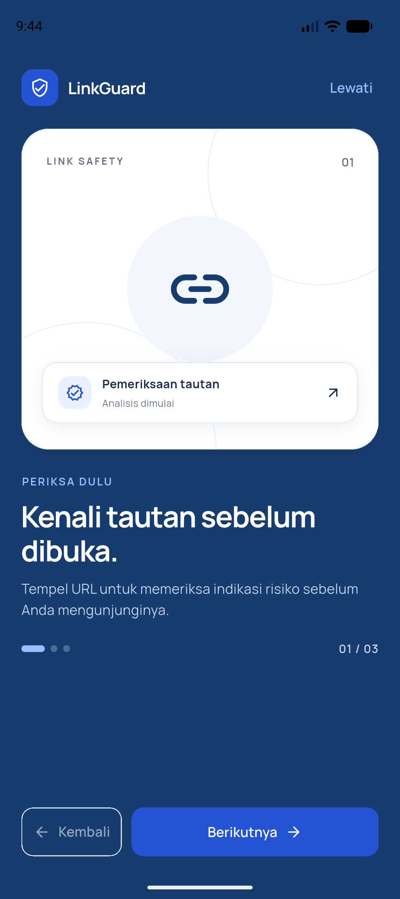
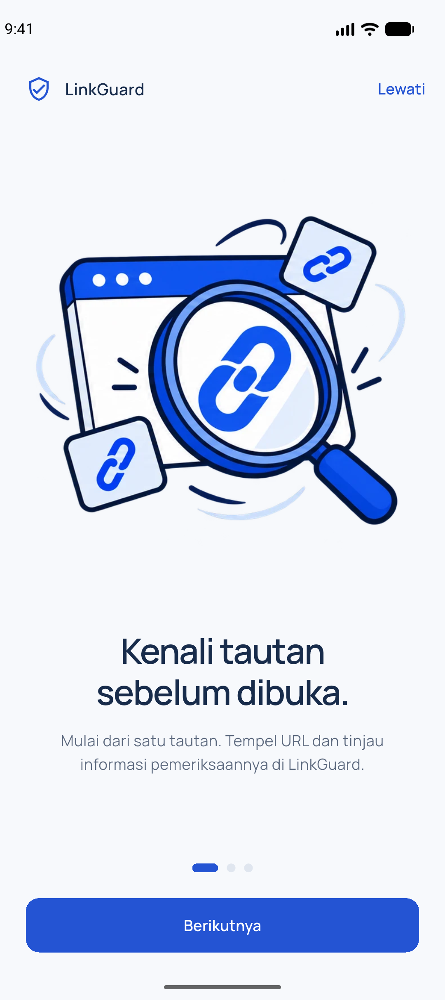
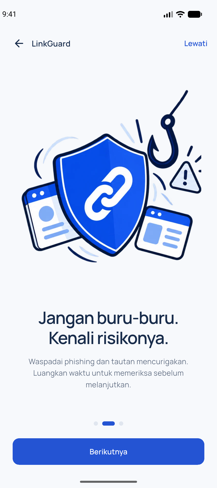
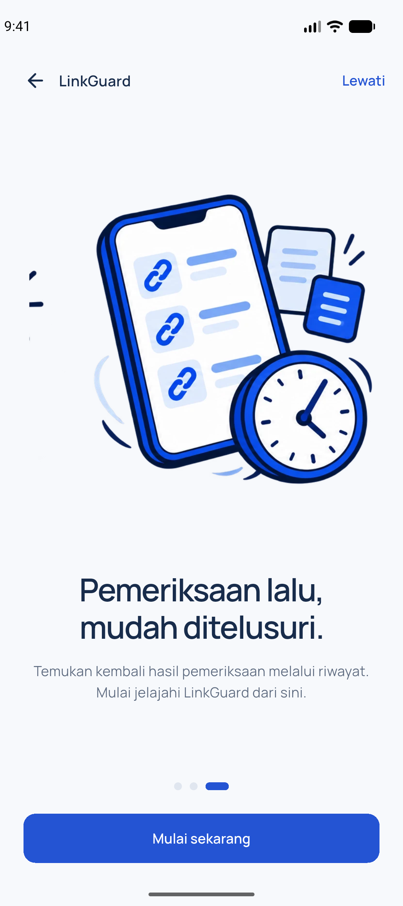
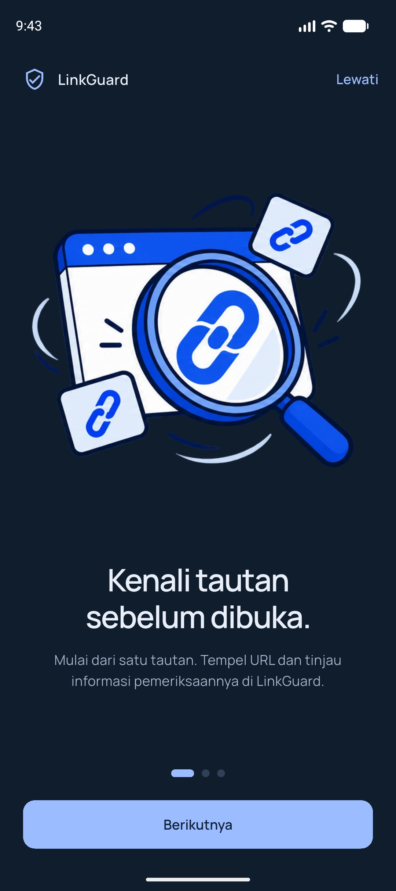
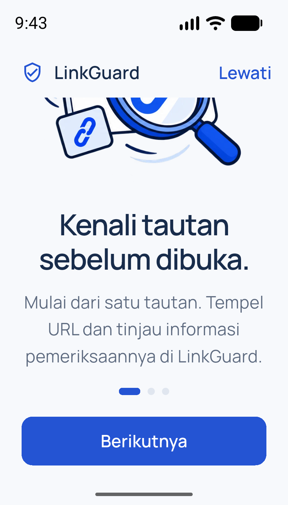
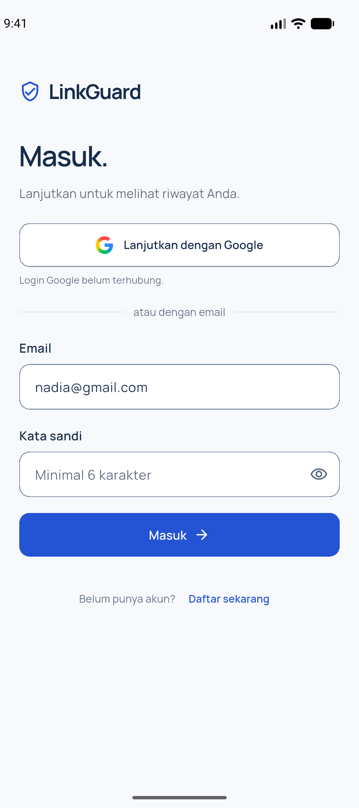

# Minggu 8: Mid Project Review & Code Review

**Agus Prasetyo · 244107020049 · TI-3H**
Pemrograman Mobile, D4 Teknik Informatika, JTI Polinema.
Pengerjaan dan verifikasi: **21 Oktober 2026**.

Laporan mengikuti [codelab Minggu 8](https://jti-polinema.github.io/flutter-codelab/08-minggu-8-mid-project-review-code-review/index.html#0).
Project pribadi melanjutkan **Campus Notify akhir Minggu 7**, tanpa membuat aplikasi
Flutter baru. Penerapan kolaborasi fitur dilakukan pada **LinkGuard kelompok PBL**
sesuai tugas dua tautan Classroom.

## Tautan pengumpulan

1. **PR fitur kelompok:** [Zuhdiaja/PBL-MOBILE #13](https://github.com/Zuhdiaja/PBL-MOBILE/pull/13).
2. **Commit laporan pribadi:** gunakan tautan commit yang menambahkan folder
   `08-week-8-mid-project-review/` ini pada repository
   [244107020049-mobile-course](https://github.com/404GH0ST/244107020049-mobile-course/commits/docs/week-8-mid-project-review/08-week-8-mid-project-review).
   Tautan commit spesifik diserahkan bersama PR pada Classroom.

PR PBL bersifat privat; dosen/reviewer memerlukan akses repository kelompok.

## Status paruh semester

| Project | Kondisi yang diverifikasi saat Minggu 8 |
| --- | --- |
| Campus Notify Minggu 7 | Kode aplikasi dipertahankan; format 44 file bersih, analyzer bersih, 22 tes lulus; tiga pencarian sterilitas menghasilkan 0 kecocokan |
| LinkGuard | Pembaruan onboarding tiga langkah, ilustrasi original besar, bahasa Indonesia, navigasi geser dan Back Android; format 140 file bersih, analyzer bersih, 185 tes lulus |
| Kolaborasi | Issue dan PR ke main tersedia; CI otomatis; satu review sejawat APPROVED oleh oninonins; verifikasi ditindaklanjuti; sudah MERGED ke main; issue #12 tertutup |

**Minimal satu review sejawat sudah terpenuhi:** oninonins memberikan Approve
pada head PR. Masukan verifikasi sudah ditindaklanjuti; analyzer bersih, 185 tes
lulus ulang, dan CI hijau. **PR #13 sudah MERGED ke main pada 21 Oktober 2026, 22.05 WIB**, dan issue #12
tertutup otomatis. Alur review hingga merge sudah terpenuhi; catatan ukuran diff
dan penyesuaian model branching tetap dicantumkan.

[Bukti merge ke main](docs/merge-verification.md).
[CI setelah merge juga berhasil](https://github.com/Zuhdiaja/PBL-MOBILE/actions/runs/39622603007),
dengan [bukti status akhir](docs/evidence/post-merge-ci.json).

[Bukti review dan tindak lanjut](docs/peer-review.md).

## Fitur utama dan stack

**Campus Notify:** autentikasi mock, sesi secure storage, daftar/detail pengumuman,
refresh sesi, notifikasi FCM dan deep link. Flutter/Dart, Riverpod, GoRouter, Dio,
Flutter Secure Storage, Firebase Messaging, dan local notifications. Struktur
feature-first memisahkan presentation, domain, dan data.

**LinkGuard:** pemeriksaan/pratinjau URL, panduan QR/berbagi, hasil, riwayat,
statistik, akun dan tema. Scope PR ini hanya onboarding: Flutter Material 3,
PageView/PageController, PopScope, AppPalette, font Manrope, serta tiga aset WebP
transparan. Tidak menambah package. Gambar menjelaskan konsep, bukan hasil scan
nyata atau bukti integrasi API/kamera. Status selesai onboarding tetap bersifat
sesi sesuai launch gate lama; persistensi tidak ditambahkan.

## Peta issue, branch, commit, dan PR

| Artefak | Tujuan |
| --- | --- |
| [Issue PBL #12](https://github.com/Zuhdiaja/PBL-MOBILE/issues/12) | Ilustrasi kecil, label Next pada layar sempit, dan Back Android |
| develop pada PBL | Sempat dibuat dari main e9bb183; bukan target PR akhir |
| feature/onboarding-visuals | Satu fitur onboarding; main sebagai target PR sesuai arahan pemilik |
| c4e3bb4 | Implementasi ilustrasi dan navigasi bahasa Indonesia |
| eddbe07 | Tes perilaku onboarding |
| be6a67a | CI formatter, analyzer, test pada main/develop |
| [PR PBL #13](https://github.com/Zuhdiaja/PBL-MOBILE/pull/13) | Masalah → solusi → cara uji → screenshot; Closes #12 setelah merge |
| docs/week-8-mid-project-review pada portfolio | Laporan, log verifikasi, dan screenshot; tidak mengubah kode akhir Minggu 7 |

Tidak mengubah default branch atau aturan proteksi repository kelompok secara
sepihak. PR tugas ini menargetkan **main**, mengikuti alur repository kelompok
dan koreksi pemilik. Model develop pada codelab dicatat sebagai referensi
pembelajaran, bukan perubahan kebijakan tim secara sepihak.

## Praktikum 1: Audit riwayat dan branching

Audit 15 commit, branch, status, simulasi tiga perbaikan pesan commit, dan
penanganan file tidak terkait ada pada
[docs/review-checklist.md](docs/review-checklist.md#praktikum-1--audit-git-dan-branching).
Riwayat yang sudah dipublikasikan tidak di-rewrite. PBL dikerjakan di worktree
terpisah agar PDF/output lokal tidak ikut masuk commit.

## Praktikum 2: Pull Request dan review

PR #13 menjelaskan masalah, solusi, scope, arsitektur, langkah reproduksi,
verifikasi otomatis, serta gambar emulator. Contoh gaya penjelasan mengikuti
[PR #11](https://github.com/Zuhdiaja/PBL-MOBILE/pull/11), dengan tambahan bukti
regresi dan checklist Minggu 8.

Checklist review manusia dan status tindak lanjut ada pada
[docs/review-checklist.md](docs/review-checklist.md#praktikum-2--issue-pr-dan-review-sejawat).
Tidak mengirim komentar atau approval atas nama anggota tim.

Target <300 baris **belum terpenuhi**: penggantian UI sekaligus menghapus 408 baris
kode lama dan mengganti tes dekorasi menjadi tes perilaku. Scope tetap satu fitur;
persetujuan pengecualian atau permintaan pemecahan PR menjadi keputusan reviewer.
Commit dipisahkan menurut tanggung jawab implementasi, pengujian, dan CI.

## Praktikum 3: Static analysis, formatter, CI

Dari `07-week-7-clean-architecture/`:

```sh
rtk proxy dart format --output=none --set-exit-if-changed lib test
rtk proxy flutter analyze --no-pub
rtk proxy flutter test --no-pub
```

Hasil: **44 file / 0 berubah, No issues found, 22 tes lulus**.
Lihat [log format](docs/evidence/campus-format.txt),
[analyze](docs/evidence/campus-analyze.txt), [tes](docs/evidence/campus-test.txt),
dan [tiga pencarian dependency](docs/evidence/campus-dependencies.txt).

Dari `PBL-MOBILE/App/Mobile/`:

```sh
rtk proxy flutter pub get
rtk proxy dart format --output=none --set-exit-if-changed lib test
rtk proxy flutter analyze --no-pub
rtk proxy flutter test --no-pub
rtk proxy flutter build apk --debug --no-pub --target-platform android-arm64
```

Hasil format/analyze/test: **140 file / 0 berubah, No issues found, 185 tes lulus**.
Build APK debug ARM64 berhasil; [log build](docs/evidence/linkguard-build-arm64.txt).
Terdapat **10 tes onboarding**, termasuk dua tes regresi yang dibuktikan gagal pada
basis lama lalu lulus di implementasi baru. Log:
[format](docs/evidence/linkguard-format.txt),
[analyze](docs/evidence/linkguard-analyze.txt),
[tes akhir](docs/evidence/linkguard-test.txt), dan
[dua kegagalan sebelum perbaikan](docs/evidence/onboarding-regressions-before.txt).

**[GitHub Actions berhasil](https://github.com/Zuhdiaja/PBL-MOBILE/actions/runs/39616467024)** pada head `be6a67a`; [bukti status](docs/evidence/github-actions.txt).

CI `.github/workflows/ci.yml` pada PBL menjalankan pub get → formatter lib/test →
analyzer → semua tes untuk PR ke main/develop. Pemeriksaan branch protection atau
penolakan merge wajib belum dikonfigurasi; check gagal hanya memberi status gagal
sampai maintainer menetapkannya sebagai required check.

## Menjalankan project

### Campus Notify yang dilanjutkan

```sh
cd 07-week-7-clean-architecture
rtk proxy flutter pub get
rtk proxy flutter devices
rtk proxy flutter run -d <device-id>
```

Konfigurasi Firebase lokal tetap mengikuti
[README Minggu 7](../07-week-7-clean-architecture/README.md#menjalankan).
Sediakan `lib/firebase_options.dart` dan `android/app/google-services.json` milik
project sendiri; file tersebut tidak dipublikasikan. Bukti FCM lama tidak
membuktikan FCM diuji ulang pada Minggu 8; kali ini hanya audit statis/unit/widget
pada Campus Notify.

### LinkGuard pada emulator Android

```sh
git clone git@github.com:Zuhdiaja/PBL-MOBILE.git
cd PBL-MOBILE
git switch feature/onboarding-visuals
cd App/Mobile
rtk proxy flutter pub get
rtk proxy flutter emulators --launch Pixel_10
rtk proxy flutter run -d emulator-5554
```

ID AVD/perangkat disesuaikan dengan mesin reviewer. Proyek memakai Flutter
3.47.7 / Dart 3.13.5 pada verifikasi lokal, tanpa upgrade dependency.

## Screenshot dan langkah uji manual

Gambar adalah **framebuffer emulator Android**, bukan browser, gambar hasil
widget/golden test, atau desain yang belum berjalan. Detail perangkat dan hasil
langkah ada pada [docs/emulator-verification.md](docs/emulator-verification.md).

| Sebelum | Sesudah: langkah 1 | Sesudah: langkah 2 | Sesudah: langkah 3 |
| --- | --- | --- | --- |
|  |  |  |  |

| Tema gelap | Layar sempit dan teks besar | Tujuan setelah selesai |
| --- | --- | --- |
|  |  |  |

## AI Prompt Challenge dan keputusan

[docs/ai-review-vs-keputusan.md](docs/ai-review-vs-keputusan.md) memuat prompt,
lima temuan/usulan awal, level, bukti, kode, penerimaan, dan penolakan.

Dua temuan utama terbukti: label Inggris pada 320 px dan Back Android yang tidak
mengikuti state. Saran akses SharedPreferences langsung dari widget ditolak:
melanggar batas data/presentation dan menambah kemampuan di luar scope visual.
Tidak menambah repository/use case satu baris untuk state halaman lokal.

## Refactoring Challenge dan hasil

- Dua masalah yang dibuktikan sudah diperbaiki dan dilindungi tes.
- CI menangani format, analyze, dan test sehingga reviewer dapat fokus pada perilaku.
- Domain/data fitur lain tetap utuh; tidak ada migrasi massal.
- Review manusia oleh oninonins berstatus Approve. Permintaan verifikasi tes/CI
  dan navigasi sudah ditindaklanjuti tanpa perubahan kode; PR sudah merged ke main.

## Refleksi

1. **LGTM buta vs approval bertanggung jawab:** approval bertanggung jawab
   membutuhkan checkout, pengujian jalur gagal/berhasil, serta bukti scope dan
   dependency. LGTM tanpa menjalankan kode dapat meloloskan bug Back dan masalah
   layar kecil walaupun tampilan utama terlihat benar.
2. **Kapan request changes?** Untuk bug yang dapat direproduksi, pelanggaran
   dependency, atau tes wajib gagal. Saran untuk nama/helper atau pengembangan
   di luar scope cukup komentar nonblocking; jangan menyamakan selera dengan bug.
3. **Saran AI yang ditolak:** persistensi langsung di widget. Jika kelak diminta,
   buat kontrak domain dan adapter data melalui composition root. Pada PR ini
   perilaku startup lama dipertahankan.
4. **Tindak lanjut setelah review sejawat:** reviewer meminta memastikan tes/CI
   berhasil dan tujuan navigasi tetap login lama. Analyzer dan 185 tes dijalankan
   ulang, CI diperiksa pada head yang sama, serta bukti emulator dicocokkan. Tidak
   mengarang perubahan kode karena reviewer sudah Approve tanpa Request changes.
   Dampaknya adalah bukti verifikasi tetap sesuai commit yang disetujui.

## Struktur artefak

```text
08-week-8-mid-project-review/
  README.md
  docs/
    review-checklist.md
    ai-review-vs-keputusan.md
    emulator-verification.md
    evidence/
  screenshots/
```

## Referensi

- [Modul Minggu 8](https://jti-polinema.github.io/flutter-codelab/08-minggu-8-mid-project-review-code-review/index.html#0)
- [PR referensi #11](https://github.com/Zuhdiaja/PBL-MOBILE/pull/11)
- [Dokumentasi PageView](https://api.flutter.dev/flutter/widgets/PageView-class.html)
- [Dokumentasi PopScope](https://api.flutter.dev/flutter/widgets/PopScope-class.html)
- [Conventional Commits](https://www.conventionalcommits.org/en/v1.0.0/)
