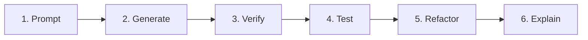
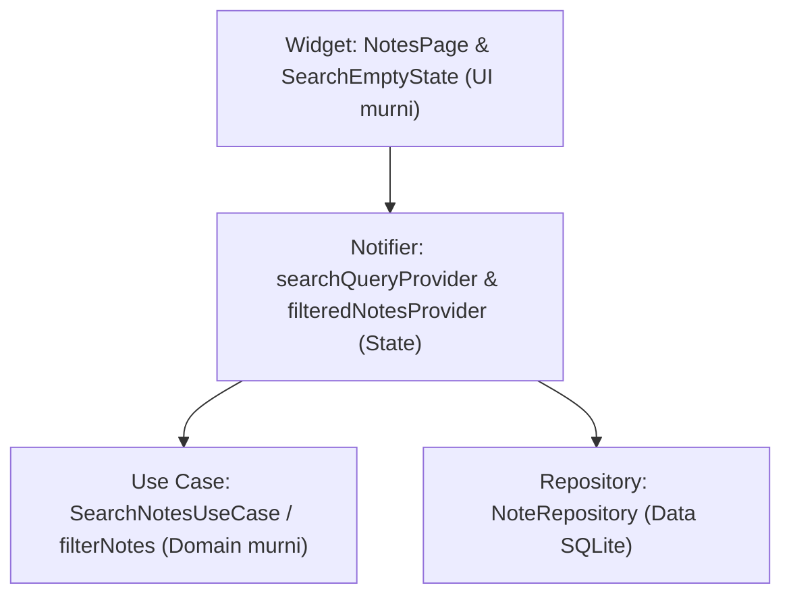
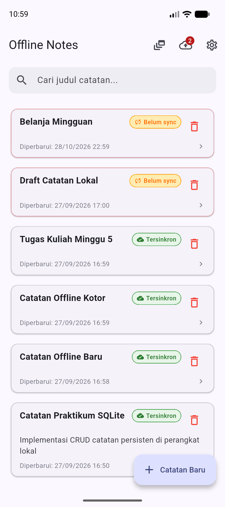
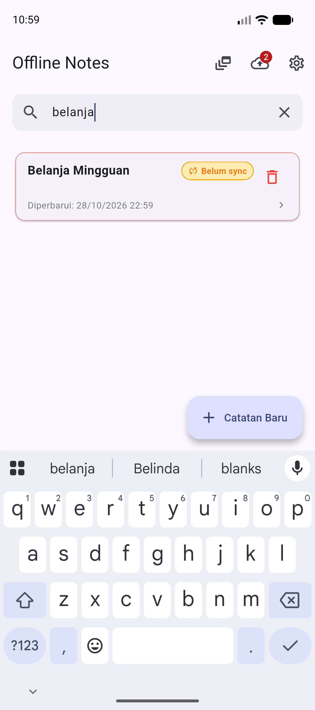
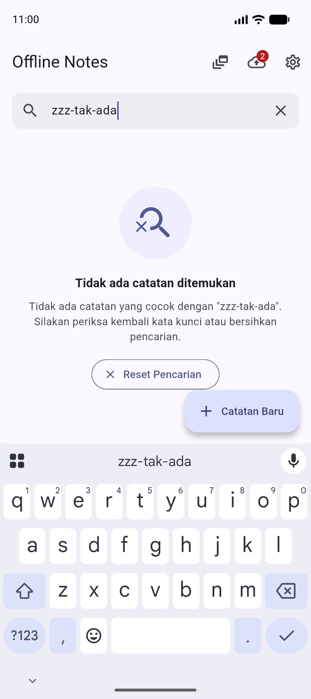

# Minggu 9: AI-Assisted Development dan Vibe Coding

Pengembangan fitur pencarian catatan offline berbasis **AI-Assisted Development** dan Clean Architecture sesuai dengan modul codelab Minggu 9. Proyek melanjutkan basis aplikasi Offline Notes tanpa membuat proyek Flutter baru dari awal.

## Identitas Mahasiswa

- Nama: Agus Prasetyo
- NIM: 244107020049
- Kelas: TI-3H
- Mata Kuliah: Pemrograman Mobile
- Program Studi: D4 Teknik Informatika
- Jurusan: Jurusan Teknologi Informasi

## Tujuan Pembelajaran

- Menjelaskan alur kerja pengembangan berbantuan kecerdasan buatan (prompt, generate, verify, test, refactor, explain)
- Menulis prompt terstruktur dengan formula lima slot untuk fitur Flutter
- Mengidentifikasi halusinasi API dan keterbatasan model bahasa pada kode Dart
- Menjalankan debugging sistematis dan refactoring ke Clean Architecture
- Menguji kode hasil AI menggunakan static analyzer dan unit test serta widget test
- Mendokumentasikan keputusan terima atau tolak usulan AI secara transparan

## Konsep Workflow AI dan Bahaya Vibe Coding

Pengembangan dengan bantuan AI bukan sekadar menyalin kode tanpa verifikasi (*vibe coding*). Developer memegang kendali penuh atas arsitektur dan kualitas kode.



| Area Kemampuan | Contoh Kasus | Sikap Pengembang |
| --- | --- | --- |
| Sangat Baik | Boilerplate Riverpod, struktur widget, draft unit test | Manfaatkan untuk efisiensi, verifikasi logika |
| Kurang Baik | API versi spesifik, batasan package, logika bisnis khusus | Uji menyeluruh, periksa dokumentasi resmi |
| Berisiko Tinggi | Kredensial, query database langsung, aturan keamanan | Tulis mandiri, jangan tempel rahasia ke prompt |

Tiga bentuk halusinasi umum pada Flutter:
1. Method fiktif yang tidak didefinisikan pada repository atau SDK
2. Penggunaan syntax package versi usang
3. Kesalahan logika pencocokan string seperti sensitivitas huruf kapital

## Praktikum 1: Prompt dan Context Engineering

### Formula Lima Slot

Prompt disusun dengan membatasi ruang asumsi AI melalui lima slot:

| Slot | Komponen | Penerapan pada Fitur Search |
| --- | --- | --- |
| 1 | Peran | Senior Flutter Developer yang menguasai Clean Architecture |
| 2 | Konteks | Proyek Offline Notes, Riverpod versi 3, SQLite, model Note |
| 3 | Tugas | Tambah fitur pencarian judul catatan dan tampilan empty state |
| 4 | Batas | Tidak mengubah arsitektur, domain murni tanpa Flutter/SQLite, maksimal 80 baris |
| 5 | Output | Pure usecase function, Riverpod providers, widget UI, serta 3 test case |

### Perbandingan Prompt

- **Prompt Buruk:** "Buatkan fitur search notes yang keren di Flutter pakai Riverpod."
  - Dampak: Menghasilkan kode monolitik di dalam satu file widget, memicu query database berulang pada setiap ketikan, dan minim pengujian.
- **Prompt Baik:** "Tambah search judul notes. Arsitektur: presentation menuju domain menuju data. Jangan panggil SQLite dari widget. Pisahkan fungsi filter murni. Sertakan empty state dan widget test."
  - Dampak: Menghasilkan pemisahan concern yang jelas, use case yang mudah diuji secara modular, dan pemenuhan batasan arsitektur.

### Pengelolaan Konteks dan Keamanan

Konteks yang dilampirkan mencakup struktur berkas, kontrak kelas Note, method yang tersedia pada NoteRepository, dan dependensi pubspec.yaml. Kredensial atau data sensitif disamarkan menggunakan placeholder seperti TOKEN_PLACEHOLDER.

Detail prompt awal dan konteks tersimpan lengkap pada [docs/ai-log.md](docs/ai-log.md).

## Praktikum 2: Generate dan Verifikasi Fitur Search

Proses verifikasi enam langkah dijalankan pada luaran awal AI:

1. **Pemeriksaan Baris per Baris:** Menelusuri seluruh instruksi dan mendeteksi adanya asumsi method fiktif pada repository.
2. **Pemeriksaan Import:** Memastikan lapisan domain tidak mengimpor package Flutter, Dio, maupun SQLite.
3. **Pemeriksaan Keberadaan API:** Memverifikasi ketersediaan method melalui pencarian teks langsung pada kode repositori.
4. **Analisis Statis:** Menjalankan analyzer hingga nol peringatan dan nol error.
5. **Pembuatan Automated Test:** Menulis pengujian jalur sukses dan jalur gagal.
6. **Uji Coba Manual:** Menguji query kosong, query cocok, dan query tidak cocok pada emulator.

### Temuan Halusinasi dan Bug Logika Awal

1. **Halusinasi Method Fiktif:** AI mengusulkan pemanggilan `repo.searchNotes(query)`.
   - Bukti: Pencarian teks pada berkas repositori menghasilkan nol kecocokan:
     ```bash
     grep -rn "searchNotes" lib/data/repositories/note_repository.dart
     ```
     Kompilasi awal gagal karena method tersebut memang tidak ada di NoteRepository.
2. **Bug Sensitivitas Huruf (Case-Sensitivity):** AI menggunakan filter bawaan `title.contains(query)`.
   - Bukti: Pencarian kata kunci "belanja" gagal menemukan catatan dengan judul "Belanja Mingguan". Solusi yang benar adalah menormalisasi kedua sisi dengan `.toLowerCase()` dan `.trim()`.

## Praktikum 3: Debug dan Refactor ke Clean Architecture

### Siklus Debugging Berbasis Test Merah

1. **Reproduksi Masalah:** Memasukkan query huruf kecil "belanja" untuk mencari judul "Belanja Mingguan".
2. **Isolasi Logika:** Memindahkan seluruh kalkulasi penyaringan ke fungsi domain murni `filterNotes` pada `lib/domain/usecases/search_notes.dart`.
3. **Uji Coba Gagal (Test Merah):** Menjalankan test filter yang gagal sebelum normalisasi string diterapkan.
4. **Perbaikan Kode (Test Hijau):** Menerapkan normalisasi string pada usecase domain:
   ```dart
   List<Note> filterNotes(List<Note> notes, String query) {
     final trimmed = query.trim().toLowerCase()
     if (trimmed.isEmpty) {
       return List<Note>.unmodifiable(notes)
     }
     return notes.where((note) {
       return note.title.toLowerCase().contains(trimmed)
     }).toList()
   }
   ```
5. **Pencatatan Akar Masalah:** String comparison bawaan Dart bersifat peka huruf kapital sehingga normalisasi teks wajib dilakukan sebelum perbandingan.

### Refactor Lapisan Arsitektur

Struktur lapisan yang diterapkan memisahkan tanggung jawab secara tegas:



- **Lapisan Widget (`lib/pages/notes_page.dart`):** Hanya bertugas merender UI dan meneruskan interaksi pengguna ke provider. Setiap method memiliki panjang kurang dari 40 baris.
- **Lapisan Notifier (`lib/data/repositories/note_repository.dart`):** Mengelola query pencarian dan menggabungkan data catatan dari SQLite dengan usecase filter.
- **Lapisan Domain (`lib/domain/usecases/search_notes.dart`):** Berisi aturan bisnis murni tanpa dependensi framework.
- **Lapisan Data (`lib/data/local/` dan `lib/data/repositories/`):** Mengelola koneksi basis data SQLite lokal.

## AI Challenge

Prompt evaluasi arsitektur diajukan kepada AI reviewer:

```text
Review kode search Flutter ini sebagai senior dev.
Konteks: feature-first (presentation -> domain <- data), Riverpod, SQLite + Dio.
Fokus: kebenaran, arsitektur, test. Abaikan style.
Beri 3 temuan + level blocker/saran + alasan.
```

### Tabel Temuan dan Keputusan

| Nomor | Temuan AI | Tingkat | Evaluasi Teknis | Keputusan |
| --- | --- | --- | --- | --- |
| 1 | Query spasi tanpa karakter teks ("   ") dianggap filter aktif dan menghasilkan daftar kosong | Blocker | Terbukti: spasi yang tidak dibersihkan mencocokkan karakter spasi pada judul | DITERIMA dan diperbaiki dengan `query.trim().toLowerCase()` |
| 2 | Tambahkan tabel Virtual SQLite FTS5 dan query pencarian native SQL untuk kecepatan | Saran | Ditolak: koleksi catatan offline lokal berskala puluhan hingga ratusan item. Penambahan tabel virtual FTS5 membutuhkan migrasi native, perombakan skema SQLite, serta kompilasi engine khusus. Filter in-memory pada domain usecase murni selesai dalam waktu kurang dari satu milidetik tanpa membebani sistem | DITOLAK demi kesederhanaan dan kestabilan arsitektur |
| 3 | Sediakan tombol pembersih interaktif pada SearchBar dan tombol reset pada Empty State | Saran | Terbukti: interaksi mobile membutuhkan jalan pintas untuk kembali ke daftar awal tanpa menghapus karakter satu demi satu | DITERIMA dan diterapkan pada SearchBar serta SearchEmptyState |

### Keputusan Berkas Proyek

| Berkas | Peran | Keputusan | Penjelasan |
| --- | --- | --- | --- |
| `lib/domain/usecases/search_notes.dart` | Domain Use Case | Dibuat Mandiri | Berisi `filterNotes` dan `SearchNotesUseCase` tanpa import Flutter atau SQLite |
| `lib/widgets/search_empty_state.dart` | Presentation Widget | Dibuat Mandiri | Menampilkan ikon ilustrasi, pesan ramah pengguna, dan aksi reset pencarian |
| `lib/data/repositories/note_repository.dart` | Repository & Notifier | Diterima dan Direfaktor | Menambahkan `searchQueryProvider` dan `filteredNotesProvider` tanpa mengubah method CRUD lama |
| `lib/pages/notes_page.dart` | Presentation Page | Diterima dan Direfaktor | Mengintegrasikan kolom pencarian, mengonsumsi data terfilter, dan membatasi ukuran method di bawah 40 baris |
| `test/search_filter_test.dart` | Pengujian Unit | Dibuat Mandiri | 7 pengujian unit memverifikasi seluruh kemungkinan kombinasi query |
| `test/search_notes_widget_test.dart` | Pengujian Widget | Dibuat Mandiri | 4 pengujian widget memverifikasi interaksi antarmuka dan empty state |

## Refactoring Challenge dan Pengujian

### Bukti Mesin Hijau

1. **Pemeriksaan Linter (`flutter analyze`):**
   ```text
   Analyzing 09-week-9-ai-assisted-development...
   No issues found! (ran in 2.1s)
   ```

2. **Pemeriksaan Format Kode (`dart format --set-exit-if-changed .`):**
   ```text
   Formatted 17 files (0 changed) in 0.04 seconds.
   ```

3. **Eksekusi Pengujian Otomatis (`flutter test`):**
   ```text
   00:00 +15: All tests passed!
   ```

Seluruh 15 skenario pengujian lulus, mencakup serialisasi model catatan, provider dengan fake repository, 7 uji unit filter domain, dan 4 uji interaksi widget.

## Mini Project: Pencarian Catatan Offline

Aplikasi menyediakan pencarian judul catatan seketika (real-time filtering) secara luring dengan arsitektur bersih.

**Stack Teknologi:**
- Flutter SDK dan Dart
- State Management: flutter_riverpod versi 3
- Basis Data Lokal: sqflite dan path
- Navigasi: go_router
- Pengujian: flutter_test

### Cara Menjalankan Aplikasi

1. Pindah ke direktori proyek:
   ```bash
   cd 09-week-9-ai-assisted-development
   ```
2. Ambil paket dependensi:
   ```bash
   flutter pub get
   ```
3. Periksa ketersediaan perangkat atau emulator:
   ```bash
   flutter devices
   ```
4. Jalankan aplikasi pada emulator target:
   ```bash
   flutter run -d emulator-5554
   ```
5. Jalankan seluruh pengujian otomatis:
   ```bash
   flutter test
   ```

## Bukti Pengujian Emulator Android

Pengujian manual dilakukan langsung pada emulator Android Pixel 10 API 37 (`emulator-5554`). Gambar ditangkap langsung melalui `adb exec-out screencap -p`.

| Skenario | Hasil yang Diharapkan | Tangkapan Layar Emulator |
| --- | --- | --- |
| Query Kosong | Kolom pencarian menampilkan placeholder dan seluruh catatan lokal ditampilkan |  |
| Query Cocok | Mengetik kata kunci "belanja" menyaring catatan dan menampilkan hanya catatan yang relevan secara case-insensitive |  |
| Query Tidak Cocok | Mengetik kata kunci "zzz-tak-ada" memunculkan Empty State informatif beserta tombol Reset Pencarian |  |

## Refleksi Praktikum

1. **Satu halusinasi AI yang ditemukan dan pembuktiannya:**
   AI mengusulkan pemanggilan method `searchNotes(query)` pada `NoteRepository`. Halusinasi ini dibuktikan fiktif melalui pencarian `grep` pada berkas `note_repository.dart` yang menghasilkan nol kecocokan, serta menyebabkan kegagalan kompilasi analyzer.

2. **Prompt yang paling membantu dan perubahannya:**
   Prompt dengan formula lima slot yang secara tegas menetapkan batasan arsitektur (domain tidak boleh mengimpor Flutter atau SQLite, batasan panjang baris kode, dan kewajiban menyertakan pengujian). Pembatasan ini mencegah AI menghasilkan kode monolitik yang mencampuradukkan UI dan basis data.

3. **Satu tindakan refactor pada kode AI:**
   Memindahkan seluruh aturan pencocokan string dari method `build()` widget ke dalam pure domain function `filterNotes` pada lapisan usecase domain, lalu memadukannya dengan `filteredNotesProvider` Riverpod.

4. **Keputusan terima atau tolak yang paling menantang:**
   Menolak rekomendasi AI untuk menambahkan tabel SQLite Virtual FTS5. Meskipun FTS5 terdengar menarik secara teoritis, implementasinya menambahkan kompleksitas native yang tidak diperlukan untuk aplikasi offline notes skala personal di mana pencarian in-memory pada domain layer terbukti instan dan jauh lebih mudah diuji.

## Referensi Pendukung

- [Modul Praktikum Minggu 9 JTI Polinema](https://jti-polinema.github.io/flutter-codelab/09-minggu-9-ai-assisted-development-vibe-coding/index.html#0)
- [Dokumentasi Resmi Riverpod](https://riverpod.dev/docs/introduction/getting_started)
- [Dokumentasi Flutter Static Analysis](https://docs.flutter.dev/tools/using-ide)
- [Panduan Praktik Terbaik GitHub Copilot](https://docs.github.com/en/copilot/using-github-copilot/best-practices)
