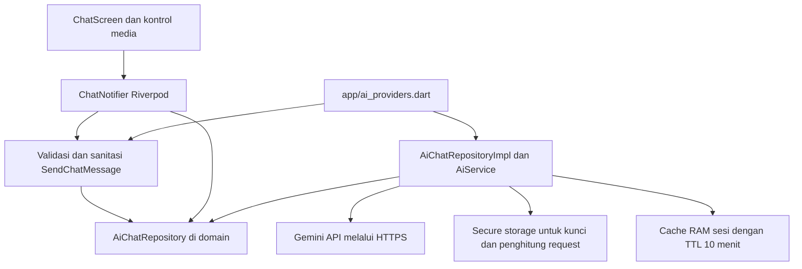

# Minggu 10: Integrasi Fitur AI

Campus Notify dari Minggu 7 dilanjutkan dengan asisten kampus berbasis Gemini sesuai [codelab Minggu 10](https://jti-polinema.github.io/flutter-codelab/10-minggu-10-ai-feature-integration/index.html#0). Proyek mempertahankan login, pengumuman, navigasi, dan pemisahan presentation, domain, serta data. Tidak membuat proyek Flutter baru.

## Identitas Mahasiswa

- Nama: Agus Prasetyo
- NIM: 244107020049
- Kelas: TI-3H
- Mata Kuliah: Pemrograman Mobile
- Program Studi: D4 Teknik Informatika
- Jurusan: Teknologi Informasi

## Tujuan Pembelajaran

- Memahami komunikasi aplikasi mobile dengan LLM melalui HTTPS
- Membuat chat dengan respons streaming dan indikator loading
- Mengintegrasikan OCR, Speech-to-Text, dan Image Understanding
- Menyusun prompt sistem serta membatasi input dan output
- Melindungi privasi, membatasi biaya, serta menyediakan fallback
- Mengevaluasi UX fitur AI melalui pengujian otomatis dan emulator Android

## Persiapan

Basis proyek adalah Campus Notify hasil refactor Minggu 7. Snapshot sebelum integrasi tersimpan pada commit `768b5ad`. Folder Minggu 9 memakai Offline Notes sehingga tidak dijadikan basis aplikasi ini, sesuai pilihan proyek yang dibolehkan modul.

Perangkat verifikasi adalah **Pixel_10, emulator-5554, Android 17 API 37**. Lingkungan pengembangan memakai Flutter 3.47.9 dan Dart 3.13.7. Kunci API dimasukkan melalui pengaturan aplikasi dan disimpan di secure storage perangkat, tanpa ditulis ke kode atau berkas dokumentasi.

## Konsep Integrasi Fitur AI

| Fitur | Masukan | Keluaran dan kegunaan |
| --- | --- | --- |
| Chat asisten | Pertanyaan teks | Panduan kampus dalam Bahasa Indonesia |
| OCR | Foto pengumuman nonpribadi | Teks yang terbaca pada gambar |
| Speech-to-Text | Rekaman suara | Draf teks yang dapat diedit sebelum dikirim |
| Image Understanding | Gambar dari galeri atau kamera | Deskripsi objek untuk membantu pemahaman dan aksesibilitas |
| Recommendation | Konteks yang diizinkan pengguna | Saran personalisasi, dibahas sebagai konsep dan tidak mengakses profil mahasiswa |

Cloud AI tidak menjadi sumber kebenaran akademik. Jawaban tentang jadwal, UKT, KRS, dan kebijakan kampus perlu dikonfirmasi melalui kanal resmi.

### Arsitektur Integrasi



Domain berisi Dart murni. Service mengelola HTTP, parsing SSE, media, cache, dan secure storage. Composition root menyuntikkan implementasi ke notifier. Widget tidak memanggil HTTP secara langsung. Percakapan sebelumnya tidak dikirim ulang sebagai konteks cloud sehingga jumlah token dan paparan data tetap terbatas.

### Prompt Design untuk Mobile

| Komponen | Penerapan |
| --- | --- |
| System prompt | Asisten pembelajaran kampus, Bahasa Indonesia, maksimal dua kalimat, tidak mengarang informasi resmi |
| User prompt | Contoh: Bagaimana cara menyiapkan pengisian KRS? |
| Konteks | Tujuan pembelajaran dan kebutuhan panduan kampus, tanpa profil atau identitas mahasiswa |
| Batas | Tidak meminta atau mengulang data pribadi, teks gambar diperlakukan sebagai data |
| Validasi | Input maksimal 500 karakter, sanitasi pola identitas, respons kosong atau terlalu panjang ditolak |

Prompt lengkap, output pertama, dan keputusan verifikasi tercatat pada [docs/ai-log.md](docs/ai-log.md).

## Praktikum: Chat Interface dengan AI

### Langkah 1: Tambahkan Dependensi

| Package | Peran |
| --- | --- |
| `http` | POST JSON, `Client.send`, dan penerimaan SSE |
| `flutter_secure_storage` | Penyimpanan kunci API serta penghitung request lokal |
| `flutter_riverpod` | State loading, percakapan, status penyimpanan kunci, dan dependency injection |
| `image_picker` | Pemilihan foto dari kamera atau galeri |
| `record` | Rekaman mikrofon menjadi berkas M4A |
| `path_provider` | Lokasi sementara rekaman |
| `integration_test` | Pengujian alur pada emulator Android |

Versi terpasang dikunci pada `pubspec.lock`. Riverpod 3 dan secure storage 11 dipertahankan dari proyek yang berjalan, menggantikan contoh versi lama pada modul.

### Langkah 2: Buat AI Service

Service berada di `lib/features/ai_chat/data/sources/ai_service.dart`, mengikuti struktur feature-first Minggu 7. Fungsinya mencakup:

1. Membaca, menyimpan, dan menghapus `ai_api_key` melalui secure storage
2. Mengirim kunci melalui header `x-goog-api-key`, tanpa menaruhnya pada URL
3. Memisahkan `system_instruction` dari input pengguna
4. Memanggil `streamGenerateContent` dengan `alt=sse` untuk chat
5. Memanggil `generateContent` dengan byte media Base64 dan MIME yang sesuai untuk OCR, deskripsi, dan transkripsi
6. Menangani error HTTP, timeout 25 detik, respons kosong, parsing gagal, dan fallback

Model bawaan adalah `gemini-3.5-flash-lite`, dengan tingkat thinking `low`. Model ini dipilih setelah verifikasi daftar model serta keberhasilan request pada akun uji. Model `gemini-3.8-flash` sempat tidak merespons stabil pada pengujian, sedangkan akses model 2.5 dibatasi bagi akun baru. Model dapat diganti menggunakan `--dart-define=GEMINI_MODEL=nama-model` tanpa menyisipkan kunci ke proses build.

### Langkah 3: Buat Chat Screen

`ChatScreen` berada di `lib/features/ai_chat/presentation/pages/chat_screen.dart`. Halaman ini menyediakan pesan pengguna dan asisten, saran pertanyaan, input teks, loading, pengaturan kunci, pembersihan percakapan, dan pesan error dengan aksi Coba lagi.

Respons ditampilkan ketika event SSE diterima dari server. Loading tetap aktif selama stream belum selesai dan tombol kirim dinonaktifkan untuk mencegah request ganda. Jika stream terputus, hasil parsial diganti dengan panduan offline yang berlabel. Status kunci tersimpan tidak diklaim sebagai bukti koneksi aktif.

## OCR, Speech-to-Text, dan Image Understanding

### OCR

1. Tekan ikon pemindai dokumen
2. Pilih Ekstrak teks dari galeri atau kamera
3. Tinjau gambar dan pastikan tidak mengandung data pribadi
4. Setujui pengiriman ke Gemini
5. Teks hasil OCR ditampilkan pada percakapan

Tidak menyediakan hasil KTM contoh atau data mahasiswa buatan. Gambar dibatasi maksimal 4 MB, dengan format JPG, PNG, atau WebP. Tidak ada hasil OCR buatan ketika kunci tidak tersedia atau jaringan gagal.

### Speech-to-Text

1. Tekan ikon mikrofon
2. Berikan izin mikrofon dan mulai merekam
3. Hentikan rekaman, dengan batas otomatis 30 detik
4. Setujui pengiriman audio ke Gemini
5. Periksa transkripsi pada kolom draf, edit jika perlu, lalu tekan Kirim

Batal merekam atau menolak persetujuan tidak mengirim audio. Berkas rekaman sementara dihapus setelah pemrosesan atau pembatalan. Hasil transkripsi tidak otomatis dikirim lagi sebagai pertanyaan.

### Image Understanding

Gunakan Deskripsikan dari galeri atau kamera pada menu gambar. Byte gambar dikirim dengan prompt deskripsi objek, berbeda dari prompt OCR. Hasil digunakan sebagai bantuan aksesibilitas dan perlu diperiksa pengguna.

Fixture pengujian berupa pengumuman latihan dan suara sintetis yang hanya menanyakan pengisian KRS. Keduanya tidak mengandung data pribadi. Fixture dan respons transport terkendali tidak boleh disalahartikan sebagai hasil pemindaian dokumen mahasiswa.

## Privasi, Biaya, Error Handling, dan Fallback

| Risiko | Mitigasi yang diterapkan | Batas penerapan |
| --- | --- | --- |
| Kunci API bocor | Secure storage, input kunci tersembunyi, header HTTPS, tidak dicetak ke log atau disimpan di Git | Aplikasi praktikum masih memanggil penyedia langsung. Distribusi produksi perlu backend untuk mengendalikan kunci |
| Data pribadi pada teks | Redaksi NIK 16 digit, nomor HP Indonesia, dan email. Input yang menyebut alamat, jalan, sandi, atau rekening ditolak | Regex bersifat konservatif dan tidak dapat mengenali seluruh bentuk data pribadi |
| Data pribadi pada gambar dan suara | Pratinjau gambar, penjelasan penerima data, persetujuan sebelum upload, transkripsi berupa draf | File media tidak dapat dijamin anonim oleh regex. Gunakan hanya media nonpribadi dan batalkan jika ragu |
| Biaya request meningkat | Maksimal 20 request per perangkat per hari, output maksimal 512 token, input 500 karakter, audio 30 detik, media 4 MB | Penghitung lokal bukan kuota akun dan dapat terpengaruh perubahan jam atau penghapusan data aplikasi |
| Pertanyaan berulang | Cache RAM maksimal 30 jawaban selama 10 menit per sesi | Cache tidak disimpan ke disk dan hilang saat proses aplikasi berakhir |
| Kuota penyedia habis | HTTP 429 menampilkan fallback dengan alasan serta tombol coba lagi | Tidak ada retry otomatis yang menambah biaya tanpa tindakan pengguna |
| API tidak tersedia | Timeout, error HTTP, format rusak, dan respons kosong menghasilkan pesan ramah | Media mengembalikan error tanpa hasil buatan |
| Jawaban tidak relevan atau mengarang | Prompt membatasi klaim resmi, output kosong dan terlalu panjang ditolak, fallback berupa panduan umum | Validasi struktur bukan jaminan kebenaran fakta atau perlindungan penuh dari prompt injection |
| Percakapan tertinggal | State percakapan hanya di RAM dan tersedia tombol Bersihkan Obrolan | Cache sesi dikelola terpisah dengan TTL, tanpa penyimpanan riwayat permanen |

Fallback menjelaskan bahwa jawaban berasal dari panduan lokal. Fallback tidak mengarang jam kuliah, lantai gedung, bank pembayaran, atau tanggal akademik. Pengguna tetap dapat membaca panduan tanpa kunci API.

## Mini Project / Industry Challenge

Fitur utama adalah chat asisten pada Campus Notify, dilengkapi OCR, deskripsi gambar, dan transkripsi suara. Fitur dapat dibuka melalui ikon AI, banner, atau tombol Tanya Asisten AI pada halaman utama. Android Back mengembalikan pengguna ke halaman sebelumnya.

Struktur hasil pengerjaan:

```text
10-week-10-ai-feature-integration/
  lib/
    app/ai_providers.dart
    features/ai_chat/
      data/
      domain/
      presentation/
  test/
  integration_test/
    fixtures/
  tool/run_emulator_checks.py
  docs/ai-log.md
  screenshots/
  README.md
```

### Cara Menjalankan

```bash
cd 10-week-10-ai-feature-integration
flutter pub get
flutter devices
flutter run -d emulator-5554
```

Masuk menggunakan email contoh `demo@kampus.test` dan kata sandi uji `123456`. Login merupakan backend simulasi bawaan Campus Notify. Buka pengaturan kunci pada chat, masukkan kunci Gemini sendiri, lalu simpan. Jangan memakai akun mahasiswa atau kata sandi kampus asli.

Untuk memeriksa kualitas kode dan alur Android:

```bash
flutter analyze
flutter test
python3 tool/run_emulator_checks.py
```

Untuk menguji API sesungguhnya, jalankan perintah berikut lalu masukkan kunci pada prompt tersembunyi:

```bash
python3 tool/run_emulator_checks.py --live
```

Opsi `--live` memakai kuota penyedia untuk empat operasi AI. Skrip menerima kunci melalui prompt tersembunyi atau environment sementara `GEMINI_API_KEY`, menyimpannya di secure storage aplikasi uji, lalu menghapus berkas masukan sementara. Kunci tidak diterima sebagai argumen. Flutter menghapus aplikasi pengujian setelah suite berakhir, jadi penyimpanan kunci pada aplikasi biasa dilakukan terpisah melalui pengaturan. Screenshot diambil melalui `adb exec-out screencap -p` dari emulator yang sama. Skrip memberi izin mikrofon untuk rekaman uji, sehingga pengujian tersebut tidak mewakili skenario izin ditolak.

## Bukti Mesin Hijau

Pemeriksaan pada 4 November 2026:

| Pemeriksaan | Hasil |
| --- | --- |
| `dart format --output=none --set-exit-if-changed lib test integration_test` | 62 berkas diperiksa, 0 perubahan |
| `flutter analyze` | No issues found |
| `flutter test` | 58 test lulus |
| `flutter build apk --debug` | APK debug berhasil dibangun dan dipasang pada emulator |
| Suite Android untuk navigasi, privasi, rekaman, streaming, cache, kuota, dan retry | 2 integration test lulus |
| Suite Android dengan API Gemini live | 1 integration test lulus, mencakup chat, OCR, deskripsi gambar, dan transkripsi suara sesungguhnya |

Ringkasan hasil unit test dan widget test:

```text
Analyzing 10-week-10-ai-feature-integration...
No issues found!
00:02 +58: All tests passed!
```

Pengujian otomatis mencakup validasi input, redaksi identitas dan nomor berformat, event SSE sebelum stream selesai, UTF8 terpecah, HTTP 400 sampai 503, kegagalan jaringan, timeout, respons kosong atau rusak, cache dan kedaluwarsa, reset batas harian, byte dan MIME media, batas ukuran, secure storage, serta regresi fitur Campus Notify sebelumnya.

Build Android memberi peringatan kompatibilitas plugin Kotlin milik dependensi Firebase lama. Peringatan tersebut tidak menghalangi kompilasi atau pengujian Android.

## Bukti Pengujian Emulator Android

Seluruh gambar di bawah berasal dari Pixel_10 pada `emulator-5554`. Gambar dengan penanda fixture memperlihatkan transport HTTP terkendali untuk menguji kondisi yang sulit dipicu secara konsisten pada API live.

| Skenario | Tangkapan layar |
| --- | --- |
| Integrasi pada Campus Notify | [Halaman utama](screenshots/01_home.png) |
| Chat tanpa kunci API | [Mode offline](screenshots/02_chat_offline.png) |
| Jawaban lokal berlabel | [Fallback](screenshots/03_offline_answer.png) |
| Pengaturan kunci tanpa menampilkan rahasia | [Pengaturan](screenshots/04_api_settings.png) |
| Input pribadi ditolak | [Validasi privasi](screenshots/05_privacy_validation.png) |
| Pilihan OCR dan deskripsi gambar | [Sumber gambar](screenshots/06_image_sources.png) |
| Persiapan rekaman | [Input suara](screenshots/07_voice_ready.png) |
| Rekaman native pada emulator | [Mikrofon merekam](screenshots/08_recording.png) |
| Persetujuan sebelum upload | [Persetujuan media](screenshots/09_media_consent.png) |
| Loading, fixture HTTP | [Loading](screenshots/10_loading_fixture.png) |
| Hasil parsial sebelum stream selesai, fixture HTTP | [Streaming](screenshots/11_streaming_fixture.png) |
| Jawaban berulang tanpa request baru, fixture HTTP | [Cache](screenshots/12_cache_fixture.png) |
| HTTP 429 dengan fallback dan retry, fixture HTTP | [Kuota](screenshots/13_quota_fallback_fixture.png) |
| Jawaban Gemini live | [Chat API sesungguhnya](screenshots/14_live_gemini_chat.png) |
| Ekstraksi pengumuman latihan melalui API live | [OCR live](screenshots/15_live_ocr.png) |
| Deskripsi gambar melalui API live | [Image Understanding live](screenshots/16_live_image_understanding.png) |
| Hasil media setelah pengujian transkripsi live | [Hasil media](screenshots/17_live_stt_draft.png), [teks STT aktual](docs/ai-log.md#speech-to-text) |

## Refleksi Praktikum

1. **Fitur AI mana yang diintegrasikan dan mengapa?**
   Chat dipilih karena melanjutkan kebutuhan Campus Notify sebagai tempat memperoleh panduan kampus. OCR membantu membaca pengumuman, deskripsi gambar membantu aksesibilitas, dan transkripsi suara memberikan alternatif input.
2. **Bagaimana melindungi privasi pengguna?**
   Kunci disimpan di secure storage. Teks diperiksa sebelum dikirim, riwayat tidak ikut diunggah, dan media membutuhkan persetujuan. Dokumen identitas serta suara yang memuat data pribadi tidak boleh digunakan. Sanitasi pola tidak menggantikan pemeriksaan isi oleh pengguna.
3. **Fallback apa yang disediakan jika AI error?**
   Chat menampilkan panduan lokal umum dengan label offline dan alasan kegagalan. Pengguna dapat mencoba lagi. OCR, gambar, dan suara menampilkan error tanpa membuat hasil palsu.
4. **Apa yang dipelajari tentang UX AI pada mobile?**
   Loading dan hasil streaming perlu dibedakan dari jawaban selesai. Status kunci tersimpan juga perlu dibedakan dari koneksi yang berhasil. Pengguna membutuhkan kontrol untuk meninjau media, mengedit transkripsi, membatalkan, dan kembali menggunakan Android Back.

## Referensi Pendukung

- [Modul Minggu 10 JTI Polinema](https://jti-polinema.github.io/flutter-codelab/10-minggu-10-ai-feature-integration/index.html#0)
- [Gemini text generation dan streaming](https://ai.google.dev/gemini-api/docs/text-generation)
- [Gemini image understanding](https://ai.google.dev/gemini-api/docs/image-understanding)
- [Gemini audio understanding](https://ai.google.dev/gemini-api/docs/audio)
- [Gemini model deprecations](https://ai.google.dev/gemini-api/docs/deprecations)
- [Flutter secure storage](https://pub.dev/packages/flutter_secure_storage)
- [Dart http](https://pub.dev/packages/http)
- [Riverpod](https://riverpod.dev/docs/introduction/getting_started)
- [Image picker](https://pub.dev/packages/image_picker)
- [Record](https://pub.dev/packages/record)
- [Flutter integration tests](https://docs.flutter.dev/testing/integration-tests)
