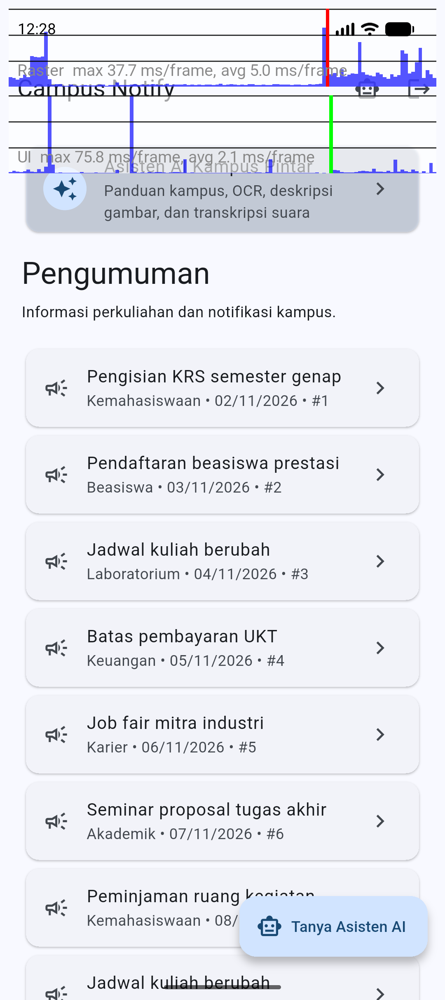
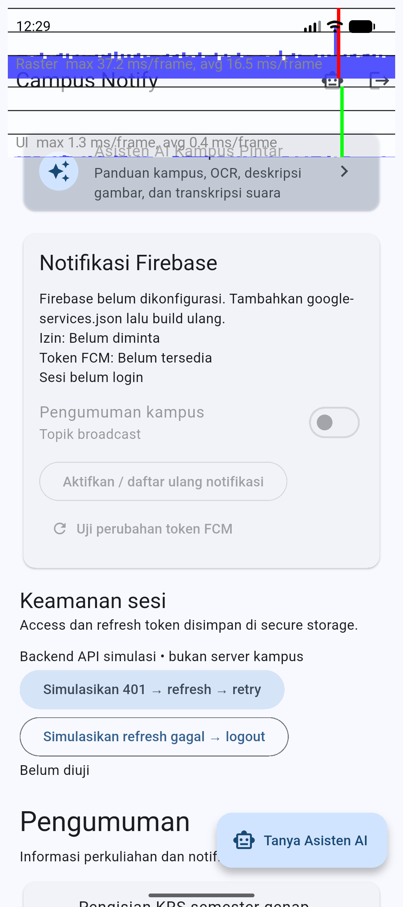

# Minggu 11: Optimasi Performa

Campus Notify dari Minggu 7–10 dioptimasi sesuai [codelab Minggu 11](https://jti-polinema.github.io/flutter-codelab/11-minggu-11-performance-optimization/index.html#0). Tidak membuat proyek Flutter baru: proyek Minggu 10 disalin apa adanya (snapshot commit `6180028`), lalu diprofil, dianalisis, dioptimasi, dan diverifikasi ulang pada emulator Android dalam profile mode.

## Identitas Mahasiswa

- Nama: Agus Prasetyo
- NIM: 244107020049
- Kelas: TI-3H
- Mata Kuliah: Pemrograman Mobile
- Program Studi: D4 Teknik Informatika
- Jurusan: Teknologi Informasi

## Tujuan Pembelajaran

- Memahami rendering pipeline Flutter (UI thread dan raster thread) serta budget frame 16,67 ms
- Memakai profile mode, timeline DevTools, dan performance overlay untuk menemukan jank
- Mengurangi rebuild dengan `const`, ekstraksi widget, `RepaintBoundary`, dan Riverpod `select`
- Menerapkan lazy loading, pagination, dan caching repository
- Memeriksa pertumbuhan memori dan kebocoran saat navigasi bolak-balik
- Membuktikan optimasi dengan angka before/after, bukan perkiraan

## Persiapan

Perangkat verifikasi adalah **Pixel_10, emulator-5554, Android 17 API 37**, dijalankan dengan `-gpu host`. Lingkungan: Flutter 3.47.9, Dart 3.13.7, DevTools 2.60.0.

Agar skenario codelab (scroll cepat, buka detail, kembali, pull to refresh) dapat diukur, sumber data contoh diperbesar menjadi 240 pengumuman dengan latensi simulasi 400 ms, dan beranda diberi pull to refresh (commit `58ddfda`). Kode UI pada commit itu masih kode Minggu 10 dan menjadi **baseline**.

## Konsep Singkat

| Konsep | Penerapan pada praktikum |
| --- | --- |
| Frame budget | 16,67 ms @60 Hz. Frame build > 16 ms dihitung sebagai jank UI |
| UI vs raster thread | Diukur terpisah dari `TimelineSummary`. Raster dicek lagi tanpa waktu tunggu swap buffer |
| Profile mode | Semua angka dari `flutter drive --profile`, bukan debug |
| CPU/build | Lazy sliver, ekstraksi widget, `const`, `select` |
| Memory | `autoDispose`, `dispose()` controller, `dumpsys meminfo` sebelum/sesudah |
| Network | Pagination 20 item, cache-first detail, fallback halaman stale |
| Gambar | Tidak relevan: list tidak memuat gambar jaringan |

## Praktikum

### Langkah 1: Baseline Profiling

`python3 tool/run_profile.py before` menjalankan skenario di emulator dalam profile mode, merekam timeline lewat `binding.traceAction`, mengambil screenshot overlay, dan mencatat `dumpsys meminfo`. Baseline dijalankan 3× tanpa overlay dan 1× dengan overlay.



### Langkah 2: Identifikasi Masalah

Empat masalah ditemukan dan dicatat di [docs/performance-findings.md](docs/performance-findings.md):

1. List tidak lazy: 240 kartu di dalam `Column` di dalam `ListView`
2. Root `HomePage` mengamati beberapa provider sehingga seluruh halaman ikut rebuild
3. Detail selalu fetch ulang walau datanya sudah ada di list
4. `announcementProvider.family` tanpa `autoDispose` dan navigasi `go`, sehingga provider detail menumpuk dan beranda dibuat ulang

### Langkah 3: Terapkan Optimasi

Enam teknik diterapkan (minimal 3 diminta):

| Teknik codelab | Lokasi |
| --- | --- |
| `ListView.builder`/lazy sliver + `RepaintBoundary` per item | `lib/app/presentation/pages/home_page.dart` (`SliverList.builder`) |
| Pagination / infinite scroll | `AnnouncementFeedNotifier` di `announcement_providers.dart`, listener ±200 px sebelum akhir |
| Ekstraksi widget + `const` | `_AssistantCard`, `_PushStatusCard`, `_SessionSecuritySection`, `_FeedHeader`, `AnnouncementTile` |
| Riverpod `select` / `Consumer` sempit | `_SessionDemoControls` |
| Cache repository | `AnnouncementRepositoryImpl`: cache-first detail, fallback halaman stale |
| Memori | `FutureProvider.autoDispose.family`, navigasi `push`/`pop`, `ScrollController.dispose()` |

### Langkah 4: Verifikasi

Skenario yang sama diulang 3× tanpa overlay dan 1× dengan overlay. Before diukur dengan harness yang sama pada kode `58ddfda` (git worktree), urutan run diselang-seling.

| Median 3 run | Before | After |
| --- | --- | --- |
| Rata-rata build frame | 3,67 ms | **0,90 ms** |
| Build frame p99 | 40,69 ms | **2,40 ms** |
| Build frame terburuk | 65,76 ms | **3,34 ms** |
| Jank UI (> 16 ms) | 6 | **0** |
| GC new-gen / old-gen | 14 / 6 | **8 / 0** |
| PSS saat list dibuka | 196,9 MB | **156,2 MB** |
| Request detail | 5 | **0** |
| Provider detail tertahan | 5 | **0** |



Pada screenshot after, grafik UI turun dari maks 75,8 ms/frame menjadi 1,3 ms/frame. Grafik raster after terlihat rata ±16,5 ms. Breakdown timeline menunjukkan waktu itu adalah `SurfaceFrame::Submit` yang menunggu vsync emulator, sedangkan kerja raster aplikasi hanya ±0,3 ms. Penjelasan lengkap ada di laporan.

### Langkah 5: Memory Profiling

Setelah 5× list → detail → back, before menahan 5 provider detail dan after menahan 0. Seluruh controller, listener, dan subscription sudah di-`dispose()`. PSS masih naik ±49 MB pada after (before ±53 MB) di region mmap anonim tempat heap Dart dan engine. Diff heap snapshot DevTools untuk memastikannya dicatat sebagai pekerjaan lanjutan di laporan.

## Mini Project / Industry Challenge

Laporan lengkap: [docs/performance-report.md](docs/performance-report.md). Isinya metodologi, koreksi pengukuran, metrik baseline, temuan, alasan setiap optimasi, hasil verifikasi per run, memori, dan trade-off. Data mentah ada di [docs/metrics/](docs/metrics/).

Struktur hasil pengerjaan:

```text
11-week-11-performance-optimization/
  lib/
    app/presentation/pages/home_page.dart
    features/announcements/
      data/        (source berhalaman, repository + cache)
      domain/      (AnnouncementPage, kontrak pagination)
      presentation/(feed notifier, detail autoDispose)
  test/performance_test.dart
  integration_test/perf_test.dart
  test_driver/perf_driver.dart
  tool/run_profile.py
  docs/
    performance-findings.md
    performance-report.md
    metrics/
  screenshots/
    before-profile.png
    after-profile.png
  README.md
```

### Cara Menjalankan

```bash
cd 11-week-11-performance-optimization
flutter pub get
flutter run --profile -d emulator-5554     # lalu buka DevTools Performance/Memory
```

Masuk dengan `demo@kampus.test` / `123456` (login simulasi). Profiling otomatis:

```bash
python3 tool/run_profile.py after --no-overlay   # metrik ke build/perf/
python3 tool/run_profile.py after                # + overlay, screenshot, meminfo
```

## Bukti Mesin Hijau

Pemeriksaan pada 14 November 2026:

| Pemeriksaan | Hasil |
| --- | --- |
| `dart format --output=none --set-exit-if-changed lib test integration_test test_driver` | 65 berkas, 0 perubahan |
| `flutter analyze` | No issues found |
| `flutter test` | 65 test lulus (58 lama + 7 baru) |
| `integration_test/perf_test.dart` profile mode di emulator | 8 run before/after lulus |
| `integration_test/ai_chat_test.dart` (regresi Minggu 10) via `tool/run_emulator_checks.py` | 2 test lulus |

```text
$ flutter analyze
Analyzing 11-week-11-performance-optimization...
No issues found! (ran in 2.7s)

$ flutter test
00:03 +65: All tests passed!
```

Test baru di `test/performance_test.dart` mencakup ukuran halaman dan `hasMore`, detail dari cache tanpa request, fallback halaman stale, `loadMore` ganda dan berhenti di akhir, error `loadMore` tanpa kehilangan item, `autoDispose` detail, dan widget test yang membuktikan tile hanya dibangun untuk area terlihat.

Build Android memberi peringatan kompatibilitas plugin Kotlin dari dependensi Firebase lama. Peringatan tersebut tidak menghalangi build atau pengujian.

## Refleksi Praktikum

1. **Optimasi mana yang paling berdampak, dan mengapa?**
   Lazy list (`SliverList.builder`). Sebelumnya setiap refresh atau kembali ke beranda membangun dan me-layout 240 kartu, sehingga muncul build terburuk 65,8 ms. Sesudahnya hanya kartu yang terlihat yang dibangun, dan build terburuk turun ke 3,3 ms. Pagination memperkuat efek ini karena data yang diproses per refresh hanya 20 item.
2. **Bagaimana memastikan optimasi bekerja dan bukan placebo?**
   Skenario yang sama diulang otomatis, before dan after diselang-seling, lalu diambil mediannya. Pengukuran juga dikoreksi saat datanya tidak masuk akal. GPU software emulator dan `fling` sempat membuat raster tampak memburuk. `Card.outlined` diukur tidak membantu sehingga di-revert. Klaim "kebocoran grafis" juga dibatalkan setelah dicek ke `meminfo`. Perilaku penting dikunci dengan test.
3. **Trade-off apa yang dihadapi?**
   State feed menjadi lebih kompleks (halaman, `hasMore`, error per halaman, penjaga race refresh). Kartu FCM dipindah ke atas list. Cache memori bisa sedikit basi sampai refresh. Emulator bukan perangkat fisik, jadi yang dipakai adalah perbandingan relatifnya.
4. **Kapan premature optimization sebaiknya dihindari?**
   Saat belum ada data profil. Pada praktikum ini raster ternyata bukan bottleneck, jadi mengoptimasi bayangan kartu tidak berguna. Optimasi dimulai dari temuan terukur (UI thread, request, provider tertahan), dan teknik yang tidak relevan, seperti optimasi gambar, tidak dipaksakan.

## Referensi Pendukung

- [Modul Minggu 11 JTI Polinema](https://jti-polinema.github.io/flutter-codelab/11-minggu-11-performance-optimization/index.html#0)
- [Flutter DevTools overview](https://docs.flutter.dev/tools/devtools/overview)
- [Flutter UI performance](https://docs.flutter.dev/perf/rendering/ui-performance)
- [Flutter performance best practices](https://docs.flutter.dev/perf/best-practices)
