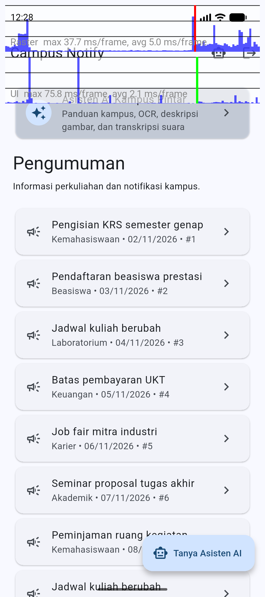

# Temuan Profiling Baseline (Langkah 1–2)

Proyek: Campus Notify (lanjutan Minggu 7–10), kode baseline pada commit `58ddfda`.
Perangkat: emulator Android **Pixel_10 (emulator-5554), Android 17 API 37, GPU host**,
build `--profile` melalui `flutter drive`.
Skenario rekaman (harness `integration_test/perf_test.dart` yang sama untuk
before dan after, lihat `performance-report.md` bagian Metodologi):

1. buka beranda dengan daftar pengumuman (240 item feed contoh);
2. scroll cepat 8× ke bawah lalu 8× ke atas (2000 px per 500 ms, ±4000 px/s, mengikuti vsync);
3. buka detail pengumuman #3, kembali, scroll ke atas;
4. pull to refresh.

Lalu, di luar rekaman frame: list → detail → back sebanyak 5 kali untuk Langkah 5 (memori).

## Metrik baseline

Median 3 run tanpa overlay (`docs/metrics/before-r{1,2,3}-*`), emulator memakai
GPU host (`-gpu host`). Nilai run dengan overlay ada di kolom terakhir.

| Metrik | Median 3 run | Run overlay |
| --- | --- | --- |
| Frame terekam | 111 | 111 |
| Rata-rata build frame (UI thread) | 3,67 ms | 4,41 ms |
| Build frame p90 / p99 | 8,26 / 40,69 ms | 12,90 / 61,53 ms |
| Build frame terburuk | 65,76 ms | 81,61 ms |
| Frame melewati budget build 16 ms (jank UI) | 6 | 8 |
| Rata-rata raster (termasuk tunggu swap buffer) | 6,32 ms | 4,95 ms |
| Frame melewati budget raster | 10 | 10 |
| GC new-gen / old-gen | 14 / 6 | 16 / 6 |
| Waktu GC di UI thread | 46,2 ms | 60,1 ms |
| PSS awal list → setelah 5× detail | 196.864 → 250.310 KB | 193.593 → 253.133 KB |
| Request ke data source dalam rekaman | 6 (1 refresh + 5 detail) | 6 |
| Provider detail tertahan setelah 5× back | 5 dari 5 | 5 dari 5 |

Screenshot overlay dari emulator (UI max 75,8 ms/frame, rata-rata 2,1 ms):

 Grafik atas = raster thread,
bawah = UI thread; garis horizontal pertama = budget 16 ms.

## Temuan (minimal 3)

### 1. List tidak lazy: seluruh 240 kartu di-build dan di-paint

`HomePage` memakai `ListView(children: [...])` dan menaruh pengumuman di
`Column(children: [for (final item in items) Card(...)])`. Column itu adalah
satu child ListView, sehingga **semua** 240 `Card` + `ListTile` di-build,
di-layout, dan direkam ke picture setiap kali list dibangun, walaupun hanya
±8 yang terlihat. Ini konsisten dengan frame build terburuk 127,7 ms (dalam
skenario, pembangunan ulang penuh terjadi setelah pull to refresh dan saat
kembali dari detail) serta picture raster yang besar karena memuat 240 kartu
berbayangan.

Bukti: build terburuk 65,8 ms dan 6 frame jank di UI thread, sedangkan kerja
raster kecil.

Kategori codelab: *non-builder list* dan *over-rebuild*.

### 2. Rebuild terlalu luas dari satu `ConsumerStatefulWidget`

`_HomePageState.build` melakukan `ref.watch(sessionDemoProvider)` dan
`ref.watch(announcementsProvider)` di root halaman. Setiap perubahan pesan
demo sesi (tombol "Simulasikan 401") atau status loading pengumuman membangun
ulang seluruh halaman, termasuk 240 kartu dan kartu FCM. Kartu FCM sendiri
dibungkus `ListenableBuilder` di dalam build root, jadi aman, tetapi bagian
lain tidak terisolasi.

Kategori codelab: *setState/listener besar di root*, kurang `select`.

### 3. Detail dimuat ulang dari source walaupun datanya sudah ada di list

Repository tidak punya cache. `AnnouncementPage` memanggil
`GetAnnouncement` → `AnnouncementSource.get(id)` (latensi simulasi 400 ms),
padahal judul dan isi sudah ada di baris feed. Navigasi list → detail
menampilkan spinner 400 ms setiap kali untuk id baru, dan refresh yang gagal
tidak punya fallback.

Kategori codelab: *repeated HTTP calls without cache*.

### 4. Memori tumbuh saat bolak-balik list ↔ detail

`announcementProvider` adalah `FutureProvider.family` **tanpa autoDispose**.
Setelah 5× list → detail → back, kelima provider detail masih ada di container
(`retainedDetailProviders: [1, 2, 3, 4, 5]`). Selain itu navigasi memakai
`context.go`, sehingga setiap kembali ke beranda `HomePage` dibuat ulang dari
nol (posisi scroll hilang, 240 kartu dibangun lagi). PSS naik ±53 MB
(median 196,9 → 250,3 MB) selama 5 putaran.

Kategori codelab: *memory growth saat navigasi bolak-balik*.

## Yang diperiksa tetapi bukan masalah

- **Controller/listener tidak di-dispose**: `LoginPage`, `ChatScreen`,
  `ApiKeyDialog`, `RecordSheet`, `PushController`, dan `PushService` sudah
  memanggil `dispose()`/membatalkan subscription. Tidak ditemukan kebocoran
  di sini.
- **Gambar tanpa resize**: daftar pengumuman tidak memuat gambar jaringan,
  jadi teknik `CachedNetworkImage` + `memCacheWidth` tidak relevan dan tidak
  dipaksakan. Gambar hanya muncul di fitur chat (dipilih pengguna dan dikirim
  sekali ke Gemini).
- **Raster**: setelah emulator memakai GPU host, kerja raster aplikasi
  (waktu `GPURasterizer::Draw` dikurangi `SurfaceFrame::Submit`) rata-rata
  hanya ±0,6 ms. Bottleneck baseline ada di UI thread, bukan raster.
  Pengukuran awal dengan GPU software emulator (lavapipe/swangle) memberi
  raster 40–80 ms untuk kode apa pun sehingga dibuang; lihat
  `performance-report.md`.
