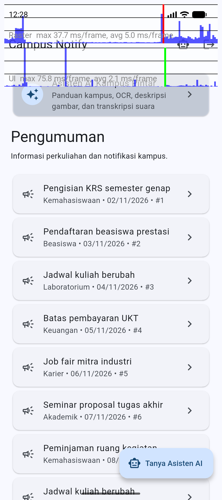
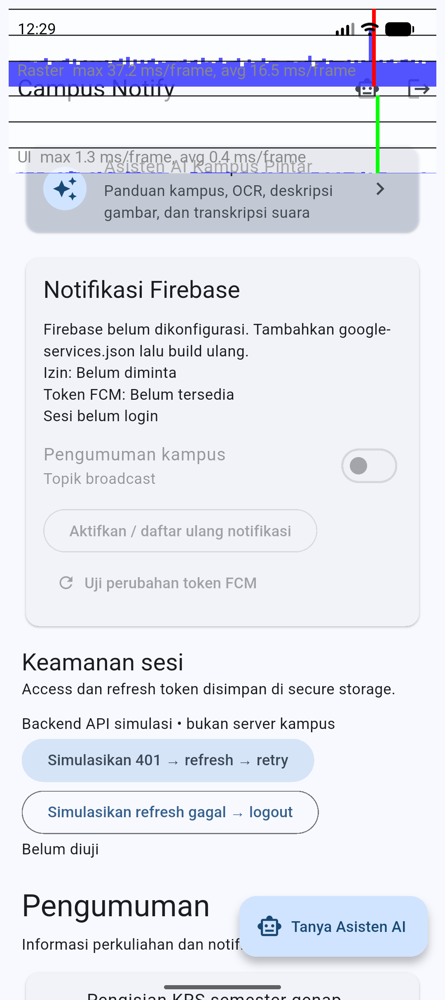

# Laporan Optimasi Performa — Campus Notify (Minggu 11)

## Ringkasan

| | Before (`58ddfda`) | After (`ab2349a`) | Perubahan |
| --- | --- | --- | --- |
| Rata-rata build frame | 3,67 ms | 0,90 ms | −75% |
| Build frame p99 | 40,69 ms | 2,40 ms | −94% |
| Build frame terburuk | 65,76 ms | 3,34 ms | −95% |
| Frame jank UI (> 16 ms) | 6 | 0 | hilang |
| Frame terekam pada skenario yang sama | 111 | 139 | +25% |
| GC new-gen / old-gen | 14 / 6 | 8 / 0 | lebih sedikit |
| Waktu GC di UI thread | 46,2 ms | 4,2 ms | −91% |
| PSS saat list dibuka | 196,9 MB | 156,2 MB | −40,7 MB |
| PSS setelah 5× list → detail → back | 250,3 MB | 204,9 MB | −45,4 MB |
| Request detail ke data source | 5 | 0 | cache |
| Provider detail tertahan setelah back | 5 | 0 | autoDispose |

Semua angka adalah **median 3 run tanpa overlay** pada emulator yang sama.
Data mentah: `docs/metrics/{before,after}-r{1,2,3}-*`.

## Lingkungan dan metodologi

- Perangkat: Pixel_10, `emulator-5554`, Android 17 API 37, Apple Silicon host,
  emulator dijalankan dengan `-gpu host`.
- Flutter 3.47.9, Dart 3.13.7, DevTools 2.60.0, build `--profile`.
- Rekaman otomatis: `tool/run_profile.py <label> [--no-overlay]` menjalankan
  `flutter drive --profile` dengan `integration_test/perf_test.dart` dan
  `test_driver/perf_driver.dart`. `binding.traceAction` merekam timeline yang
  sama dengan tab Performance DevTools, lalu `TimelineSummary` menulis
  ringkasan frame (`*-scenario.timeline_summary.json`).
- Skenario: list → scroll cepat 8× turun dan 8× naik (2000 px per 500 ms,
  animasi mengikuti vsync) → detail #3 → back → scroll ke atas → pull to
  refresh. Untuk memori: 5× list → detail → back, lalu
  `adb shell dumpsys meminfo` sebelum dan sesudah (`*-meminfo.txt`).
- Before diukur dengan harness yang sama pada kode commit `58ddfda` (git
  worktree). Satu-satunya perbedaan pada harness adalah nama provider yang
  ditunggu (`announcementsProvider` → `announcementFeedProvider`).
- Urutan run diselang-seling (before, after, before, …) dan aplikasi di
  force-stop di antara run agar kondisi emulator setara.
- Screenshot `screenshots/before-profile.png` dan `after-profile.png` diambil
  dari emulator dengan `adb exec-out screencap` tepat setelah skenario selesai,
  dengan `showPerformanceOverlay` aktif (`--dart-define=PERF_OVERLAY=true`).
  Grafik atas = raster thread, bawah = UI thread.

### Koreksi metodologi selama praktikum

1. **GPU software emulator.** Run pertama memakai mode GPU bawaan AVD yang
   ternyata `vulkan: lavapipe, gles: swangle` (rendering CPU). Raster terbaca
   40–80 ms per frame untuk before maupun after dan sangat bervariasi
   (raster after sempat tampak *lebih buruk*). Pengecekan log emulator
   menunjukkan penyebabnya bukan aplikasi, sehingga emulator dijalankan ulang
   dengan `-gpu host` dan **semua** angka diukur ulang.
2. **Fling di test live.** `tester.fling` hanya menghasilkan satu frame per
   gesture pada binding live, sehingga rekaman hanya berisi ±90 frame dan
   didominasi frame awal gesture. Scroll diganti `ScrollPosition.animateTo`
   yang berjalan per vsync seperti scroll pengguna.
3. **Raster 16 ms konstan.** Pada 1 dari 3 run after tanpa overlay dan pada
   run overlay after, setiap frame raster ±16,5 ms. Breakdown timeline
   menunjukkan 16,0 ms berada di `SurfaceFrame::Submit` (menunggu swap buffer
   / vsync emulator), sedangkan encode hanya 0,53 ms. Kerja raster aplikasi
   (`GPURasterizer::Draw` − `Submit`) dihitung terpisah:

   | Run | Before | After |
   | --- | --- | --- |
   | r1 / r2 / r3 (rata-rata ms) | 0,32 / 0,60 / 0,65 | 0,44 / 0,26 / 0,42 |
   | Run overlay | 0,74 | 0,26 |

   Kesimpulan: raster bukan bottleneck di aplikasi ini, baik before maupun
   after. Angka "missed raster budget" pada after-r2 dan screenshot after
   (raster avg 16,5 ms) berasal dari presentasi emulator, bukan dari kode.

## Temuan baseline

Detail di [`performance-findings.md`](performance-findings.md). Ringkasnya:

1. List 240 kartu dibangun di `Column` di dalam `ListView` → semua item
   di-build/di-layout sekaligus.
2. Root `HomePage` mengamati beberapa provider → rebuild seluruh halaman.
3. Detail selalu fetch ulang walau datanya sudah ada di list (tanpa cache).
4. `announcementProvider.family` tanpa autoDispose dan navigasi `context.go`
   → provider detail menumpuk, `HomePage` dibuat ulang setiap kembali.

## Optimasi yang diterapkan (6 dari 8 teknik codelab)

### 1. Lazy list: `CustomScrollView` + `SliverList.builder`

`lib/app/presentation/pages/home_page.dart`. Item hanya di-build saat masuk
viewport (+ cache extent). `SliverList.builder` juga otomatis membungkus tiap
item dengan `RepaintBoundary` (`addRepaintBoundaries: true`), sehingga repaint
satu item tidak mengecat ulang tetangganya.

Alasan: temuan 1 adalah penyebab terbesar frame build lambat. Widget test
`performance_test.dart` membuktikan setelah ≥60 item dimuat, tile yang
di-build kurang dari sepertiganya.

### 2. Pagination / infinite scroll

`AnnouncementFeedNotifier` (`announcement_providers.dart`) memuat 20 item per
halaman; `ScrollController` di `_HomeFeedState` memanggil `loadMore()` saat
`extentAfter < 200` (±200 px sebelum akhir list, sesuai codelab). Penjaga:
`loadMore` ganda diabaikan, berhenti saat `hasMore == false`, error halaman
berikutnya tidak menghapus item yang sudah tampil, dan hasil lama dibuang bila
feed sudah di-refresh (`identical(state.value, loading)`).
`ScrollController` dilepas di `dispose()`.

Alasan: menghindari parsing dan mapping 240 baris sekaligus saat refresh;
GC new-gen turun dari 14 menjadi 8 dan old-gen dari 6 menjadi 0 (median).

### 3. Ekstraksi widget + `const`

`HomePage` dipecah menjadi `_AssistantCard`, `_PushStatusCard`,
`_SessionSecuritySection`, `_SessionDemoControls`, `_FeedHeader`,
`AnnouncementTile`, dan `_RetryMessage`. Bagian statis dipasang sebagai
`const` di `SliverChildListDelegate.fixed`, sehingga tidak di-build ulang saat
feed berubah. `HomePage` sendiri kini `ConsumerWidget` yang tidak mengamati
provider apa pun.

### 4. Riverpod `select` dan `Consumer` sempit

`_SessionDemoControls` memakai
`ref.watch(sessionDemoProvider.select((s) => s.busy))` untuk tombol dan
`Consumer` kecil dengan `select((s) => s.message)` untuk teks status.
Kartu FCM hanya mendengarkan `PushController` miliknya sendiri.

### 5. Cache repository (cache-first detail, stale fallback feed)

`AnnouncementRepositoryImpl` menyimpan halaman dan entity per id di memori
sesi:

- detail: cache-first dari baris feed → list → detail → back tanpa request
  (5 → 0 request detail dalam skenario);
- feed: network-first; bila request gagal, halaman yang pernah dimuat
  dikembalikan (stale) alih-alih error.

Ini adalah varian *stale-while-revalidate* yang paling sederhana untuk data
contoh di memori; Hive tidak ditambahkan karena feed belum perlu persisten
lintas sesi.

### 6. Memori: `autoDispose` + navigasi `push/pop`

`announcementProvider` menjadi `FutureProvider.autoDispose.family` sehingga
detail yang ditutup dibuang (5 → 0 provider tertahan). Tile membuka detail
dengan `context.push` dan tombol back memakai `pop` (atau `go(home)` bila
dibuka dari deep link tanpa riwayat), sehingga `HomePage`, posisi scroll, dan
halaman yang sudah dimuat tetap utuh.

### Teknik yang tidak dipakai

- **`CachedNetworkImage` + `memCacheWidth`**: list tidak memuat gambar
  jaringan.
- **Card tanpa bayangan (`Card.outlined`)**: dicoba pada fase GPU software,
  raster rata-rata justru 38,9 → 45,0 ms (noise). Tidak ada bukti manfaat →
  di-revert. Contoh placebo yang tertangkap karena diukur.

## Verifikasi (after)

| Metrik | r1 | r2 | r3 | Median | Overlay |
| --- | --- | --- | --- | --- | --- |
| Frame | 139 | 140 | 139 | 139 | 136 |
| Build rata-rata (ms) | 0,90 | 0,79 | 0,92 | 0,90 | 0,75 |
| Build p99 (ms) | 2,40 | 2,23 | 2,47 | 2,40 | 2,21 |
| Build terburuk (ms) | 2,72 | 3,59 | 3,34 | 3,34 | 3,65 |
| Jank UI | 0 | 0 | 0 | 0 | 0 |
| GC new/old | 8/0 | 2/2 | 8/0 | 8/0 | 6/2 |
| PSS awal → akhir (MB) | 156,2 → 204,9 | 161,5 → 208,6 | 152,2 → 203,8 | 156,2 → 204,9 | 162,3 → 207,2 |
| Request data source | 9 | 9 | 9 | 9 | 9 |

Request after = 1 refresh + 8 halaman yang dimuat saat scroll; request
detail 0. Before = 1 refresh + 5 detail, tetapi seluruh 240 item diproses di
setiap fetch.

Perbandingan before:

| Metrik | r1 | r2 | r3 | Median | Overlay |
| --- | --- | --- | --- | --- | --- |
| Frame | 121 | 111 | 111 | 111 | 111 |
| Build rata-rata (ms) | 2,13 | 4,18 | 3,67 | 3,67 | 4,41 |
| Build p99 (ms) | 25,67 | 53,02 | 40,69 | 40,69 | 61,53 |
| Build terburuk (ms) | 65,76 | 68,16 | 62,46 | 65,76 | 81,61 |
| Jank UI | 3 | 6 | 6 | 6 | 8 |
| GC new/old | 14/6 | 16/6 | 14/4 | 14/6 | 16/6 |
| PSS awal → akhir (MB) | 194,6 → 251,7 | 196,9 → 249,7 | 197,4 → 250,3 | 196,9 → 250,3 | 193,6 → 253,1 |

Screenshot overlay dari emulator: before UI max 75,8 ms/frame (lonjakan saat
refresh dan kembali dari detail), after UI max 1,3 ms/frame. Raster after
±16,5 ms adalah waktu tunggu swap buffer emulator (lihat Koreksi metodologi
nomor 3).

| Before | After |
| --- | --- |
|  |  |

### Memory profiling (Langkah 5)

- Kebocoran yang ditemukan: provider detail tertahan (5/5) → diperbaiki
  dengan `autoDispose` (0/5, juga diuji di unit test).
- Controller, listener, dan stream subscription di `LoginPage`,
  `ChatScreen`, `ApiKeyDialog`, `RecordSheet`, `PushController`, `PushService`,
  dan `ScrollController` baru di `_HomeFeedState` sudah di-`dispose()`.
- PSS masih naik ±49 MB selama 5 putaran detail pada after (before ±53 MB),
  walau tidak ada provider yang tertahan. Rincian `dumpsys meminfo` (before run r2, after run r1):

  | Kategori | Before awal → akhir (KB) | After awal → akhir (KB) |
  | --- | --- | --- |
  | Native Heap | 46.245 → 54.493 | 34.021 → 48.941 |
  | Unknown (mmap anonim: heap Dart VM, alokasi engine) | 51.593 → 107.641 | 23.449 → 67.529 |
  | Java Heap | 13.952 → 11.632 | 14.000 → 13.088 |

  Titik awal
  after jauh lebih rendah karena hanya 20 item dan tile terlihat yang
  dibuat. Kenaikan ada di region anonim tempat heap Dart dan engine tinggal;
  Dart VM tidak selalu mengembalikan halaman memori ke OS setelah GC sehingga
  PSS cenderung bertahan di titik tertinggi. Memastikan apakah ada objek Dart
  yang bocor butuh diff heap snapshot di tab Memory DevTools; langkah itu
  belum diotomasi dan dicatat sebagai pekerjaan lanjutan.

## Trade-off

- **Layout beranda berubah**: kartu FCM dan Keamanan sesi dipindah ke atas
  list, karena dengan infinite scroll bagian bawah list baru tercapai setelah
  seluruh 240 item dimuat.
- **Kompleksitas state**: feed kini butuh notifier dengan `nextPage`,
  `hasMore`, `loadingMore`, error per halaman, dan penjaga race refresh.
  Ditutup oleh 3 unit test notifier/repository.
- **Cache memori**: data detail bisa sedikit basi sampai pull to refresh.
  Cache hilang saat aplikasi ditutup; dapat diganti Hive/SQLite bila perlu.
- **Overlay dan emulator**: angka emulator bukan pengganti perangkat fisik,
  tetapi perbandingan before/after valid karena kondisi disamakan dan diulang.

## Cara mereproduksi

```bash
# emulator dengan GPU host
$ANDROID_HOME/emulator/emulator -avd Pixel_10 -gpu host
cd 11-week-11-performance-optimization
python3 tool/run_profile.py after --no-overlay   # metrik bersih
python3 tool/run_profile.py after                # + overlay & screenshot
# baseline
git worktree add /tmp/w11-before 58ddfda
# salin integration_test/perf_test.dart dan tool/run_profile.py ke worktree,
# ganti announcementFeedProvider -> announcementsProvider, lalu
python3 tool/run_profile.py before --no-overlay
```

Untuk analisis manual, `flutter run --profile -d emulator-5554` lalu buka
DevTools → Performance (flame chart) dan Memory (heap snapshot).
