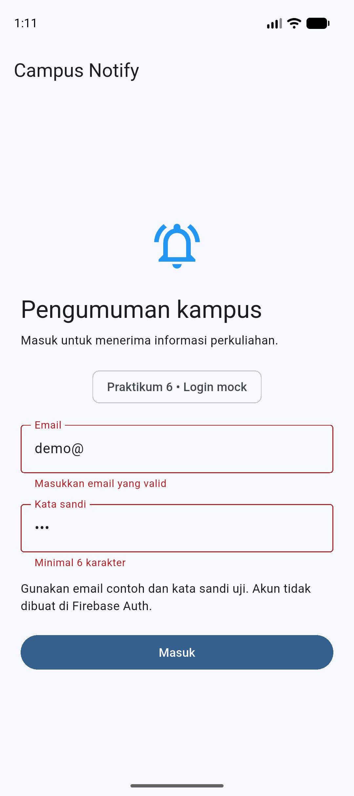
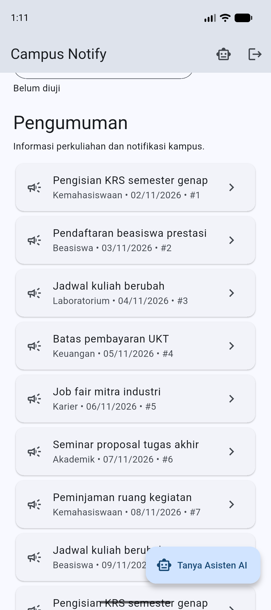
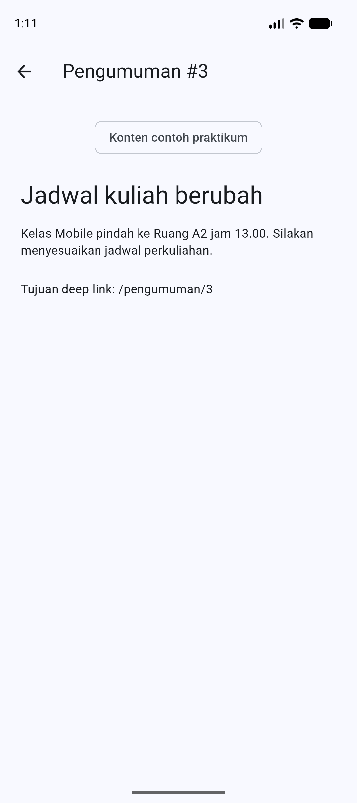

# Minggu 12: Testing dan Quality Assurance

Campus Notify dari Minggu 7–11 diuji sesuai [codelab Minggu 12](https://jti-polinema.github.io/flutter-codelab/12-minggu-12-testing-quality-assurance/index.html#0). Codelab membolehkan memakai proyek yang sudah ada, jadi tidak ada proyek Flutter baru. Proyek Minggu 11 disalin apa adanya (snapshot commit `9ef2f76`), lalu fitur utamanya diuji: **login** dan **feed pengumuman → detail**. Satu bug validasi ditemukan saat menulis skenario dan diperbaiki bersama test regresinya.

## Identitas Mahasiswa

- Nama: Agus Prasetyo
- NIM: 244107020049
- Kelas: TI-3H
- Mata Kuliah: Pemrograman Mobile
- Program Studi: D4 Teknik Informatika
- Jurusan: Teknologi Informasi

## Tujuan Pembelajaran

- Memilih jenis test yang tepat: unit, widget, atau integration
- Menulis test berbasis perilaku dengan pola Arrange, Act, Assert
- Mengganti sumber data asli dengan fake repository agar hasil test konsisten
- Menguji interaksi UI dengan `Key`, `enterText`, `tap`, dan `pump`/`pumpAndSettle`
- Menjalankan integration test pada emulator Android
- Mencegah regresi dengan test yang gagal sebelum perbaikan dan lulus sesudahnya

## Persiapan

Perangkat verifikasi: **Pixel_10, emulator-5554, Android 17**. Lingkungan: Flutter 3.47.9, Dart 3.13.7. Paket `flutter_test` dan `integration_test` (SDK) sudah ada di `dev_dependencies` sejak Minggu 10, jadi `pubspec.yaml` tidak diubah. Nama paket proyek adalah `campus_notify`, sehingga import contoh codelab (`testing_lab/...`) disesuaikan menjadi `package:campus_notify/...`.

## Pemetaan Langkah Codelab

| Langkah codelab | Penerapan di Campus Notify |
| --- | --- |
| 1. Memilih jenis test | Unit untuk aturan validasi dan notifier feed, widget untuk `LoginPage` dan `HomePage`, integration untuk alur login → detail di emulator |
| 2. Kode yang mudah diuji | Aturan login dipindah ke fungsi murni `validateEmail`/`validatePassword` di domain. Repository sudah diinjeksi lewat provider Riverpod |
| 3–4. Unit test + AAA + edge case | `test/login_validation_test.dart` (setara `isValidTaskTitle`): kosong, whitespace, batas 5/6 karakter, format email setengah jadi |
| 5. Kontrak sumber data | Sudah ada: `abstract interface class AnnouncementRepository` (setara `TaskRepository`) |
| 6. Fake repository | `FakeFeedRepository({items, error})` di `test/fakes.dart`, setara `FakeTaskRepository`. Ada test sukses, kosong, dan gagal |
| 7–8. Widget test + interaksi | `test/login_page_test.dart` dan `test/home_feed_widget_test.dart` memakai `Key('login-email-field')`, `Key('login-password-field')`, `Key('login-submit-button')`, `ValueKey('announcement-tile-<id>')`. Tanpa `Future.delayed`: loading diuji dengan `Completer` |
| 9. Integration test | `integration_test/app_test.dart` memanggil `app.main()` dan berjalan di emulator |
| 10. Mencegah regresi | Bug validasi login dibuktikan gagal pada kode lama, lalu lulus setelah perbaikan (lihat di bawah) |

## Skenario Pengujian

| # | Skenario | Jenis | Kategori | File |
| --- | --- | --- | --- | --- |
| 1 | Email valid diterima, spasi di tepi diabaikan | Unit | Sukses | `login_validation_test.dart` |
| 2 | Email kosong, `null`, atau whitespace → "Email wajib diisi" | Unit | Edge case | `login_validation_test.dart` |
| 3 | `@`, `demo@`, `@kampus.test`, `demo@kampus`, email berspasi, `a@@b.c` ditolak | Unit | Edge case / regresi | `login_validation_test.dart` |
| 4 | Kata sandi tepat 6 karakter diterima, 5 karakter ditolak | Unit | Nilai batas | `login_validation_test.dart` |
| 5 | Kata sandi 6 spasi ditolak | Unit | Edge case / regresi | `login_validation_test.dart` |
| 6 | Use case `Login` menolak input invalid tanpa memanggil repository | Unit | Gagal | `login_validation_test.dart` |
| 7 | Feed meneruskan data dari fake repository | Unit | Sukses | `announcement_feed_test.dart` |
| 8 | Feed kosong → list kosong, `hasMore` false | Unit | Data kosong | `announcement_feed_test.dart` |
| 9 | Failure repository menjadi state error, **bukan** list kosong | Unit | Gagal | `announcement_feed_test.dart` |
| 10 | Failure saat `loadMore` menjaga 20 item yang sudah tampil | Unit | Gagal | `announcement_feed_test.dart` |
| 11 | Tampilan awal login: dua field, tombol Masuk, tanpa error | Widget | Awal | `login_page_test.dart` |
| 12 | Input invalid menampilkan pesan, login tidak dipanggil | Widget | Invalid | `login_page_test.dart` |
| 13 | Form kosong menampilkan pesan wajib diisi | Widget | Invalid | `login_page_test.dart` |
| 14 | Input valid: teks "Memuat sesi…", tombol nonaktif, lalu sesi tersimpan | Widget | Loading + sukses | `login_page_test.dart` |
| 15 | Failure jaringan tampil sebagai pesan ramah, sesi tidak disimpan | Widget | Gagal | `login_page_test.dart` |
| 16 | Beranda menampilkan loading lalu daftar pengumuman | Widget | Loading + sukses | `home_feed_widget_test.dart` |
| 17 | Feed kosong menampilkan "Belum ada pengumuman." | Widget | Data kosong | `home_feed_widget_test.dart` |
| 18 | Feed gagal → pesan error, "Coba lagi" memulihkan daftar | Widget | Gagal + pulih | `home_feed_widget_test.dart` |
| 19 | Login invalid → login valid → feed → detail #3 → kembali → logout | Integration | Alur utama | `integration_test/app_test.dart` |

Test lama dari Minggu 6–11 (65 test) tetap dijalankan sebagai suite regresi.

## Praktikum

### Temuan dan Perbaikan Bug (Langkah 10)

Saat menulis skenario edge case, ditemukan bahwa aturan login ditulis di tiga tempat dan tidak konsisten:

- `LoginPage` hanya memeriksa `value.contains('@')`, sehingga `@` atau `demo@` lolos form.
- Use case `Login` memakai aturan yang sama (`contains('@')` dan panjang ≥ 6), sehingga kata sandi berisi 6 spasi ikut dikirim ke repository.

Perbaikan (commit `c4db981`): aturan dipindah ke `lib/features/auth/domain/login_validation.dart` dan dipakai bersama oleh form dan use case. Form dan use case kini tidak bisa lagi berbeda pendapat tentang input yang valid. Validasi di `MockAuthSource` dibiarkan karena berperan sebagai validasi sisi server.

Bukti regresi: test use case dijalankan pada kode `lib/` sebelum perbaikan (`git stash`), lalu sesudahnya.

```text
# sebelum perbaikan
00:00 +0 -1: email setengah jadi tidak pernah sampai ke repository [E]
  Expected: <Instance of 'ValidationFailure'>
    Actual: <null>
00:00 +0 -2: kata sandi 6 spasi ditolak sebelum request [E]
  Expected: <Instance of 'ValidationFailure'>
    Actual: <null>
00:00 +0 -2: Some tests failed.

# sesudah perbaikan
00:00 +2: All tests passed!
```

### Integration Test di Emulator (Langkah 9)

```bash
python3 tool/run_app_test.py
# membungkus: flutter test integration_test/app_test.dart -d emulator-5554
```

Skrip menjalankan test, lalu mengambil screenshot emulator setiap kali test mencetak `SCREENSHOT:<nama>`. Karena `flutter test` memasang ulang aplikasi, skrip juga memberi izin `POST_NOTIFICATIONS` sebelum login. Tanpa izin ini, dialog sistem menutupi layar. Test menghapus sesi dari run sebelumnya (secure storage) terlebih dahulu, sehingga selalu dimulai dari halaman login.

| Login invalid | Feed pengumuman | Detail pengumuman #3 |
| --- | --- | --- |
|  |  |  |

```text
00:00 +0: login, buka pengumuman, kembali, lalu logout
00:13 +1: All tests passed!
```

## Bukti Mesin Hijau

Pemeriksaan pada 14 November 2026:

| Pemeriksaan | Hasil |
| --- | --- |
| `dart format --output=none --set-exit-if-changed lib test integration_test test_driver` | 71 berkas, 0 perubahan |
| `flutter analyze` | No issues found |
| `flutter test` | 85 test lulus (65 lama + 20 baru) |
| `flutter test integration_test/app_test.dart -d emulator-5554` | 1 test lulus (±13 detik) |
| `flutter test --coverage` | 68,3% baris (861/1260) |

```text
$ flutter analyze
Analyzing 12-week-12-testing-quality-assurance...
No issues found! (ran in 2.7s)

$ flutter test
00:05 +85: All tests passed!
```

### Coverage

| Berkas fitur yang diuji | Baris tercakup |
| --- | --- |
| `features/auth/domain/login_validation.dart` | 100% (8/8) |
| `features/auth/domain/usecases/login.dart` | 100% (7/7) |
| `features/auth/presentation/pages/login_page.dart` | 100% (39/39) |
| `features/announcements/presentation/providers/announcement_providers.dart` | 100% (37/37) |
| `features/announcements/data/repositories/announcement_repository_impl.dart` | 100% (15/15) |
| `features/announcements/presentation/pages/announcement_page.dart` | 91,7% (22/24) |
| `app/presentation/pages/home_page.dart` | 87,2% (116/133) |

Coverage hanya menunjukkan baris yang dieksekusi, tidak membuktikan perilakunya sudah benar. Karena itu setiap test di atas memeriksa hasil (`expect`), bukan sekadar menjalankan kode. Angka total tertahan oleh kode platform (Firebase/FCM, perekam suara, secure storage) yang hanya bisa diuji di perangkat.

## Temuan yang Belum Diselesaikan

1. **Kode platform belum teruji di unit test.** `push_service.dart` (4,2%), `record_sheet.dart` (1,7%), dan `token_store.dart` (11,1%) memanggil plugin native. Kode ini perlu dibungkus abstraksi tambahan atau diuji lewat integration test di perangkat. Belum dikerjakan karena di luar alur utama minggu ini.
2. **Dialog izin notifikasi tidak diuji.** Izin diberikan dari skrip host (`pm grant`), sehingga alur "pengguna menolak notifikasi" belum diverifikasi otomatis.
3. **`MockAuthSource` masih punya aturan validasi sendiri** (`contains('@')`). Ini sengaja disisakan sebagai simulasi server, tetapi saat backend asli dipakai, pesan error dari server perlu diuji terpisah.
4. **Integration test memakai sumber data simulasi** (latensi 400 ms, di memori). Kondisi jaringan asli (timeout, offline) hanya diuji di level unit dengan fake.
5. Peringatan kompatibilitas plugin Kotlin dari dependensi Firebase lama muncul saat build Android. Peringatan ini tidak menghalangi build atau test.

## Cara Menjalankan

```bash
cd 12-week-12-testing-quality-assurance
flutter pub get
flutter test                                   # unit + widget
flutter test --coverage                        # laporan di coverage/lcov.info
flutter analyze
python3 tool/run_app_test.py                   # integration + screenshot emulator
```

Login manual: `demo@kampus.test` / `123456` (login simulasi).

Struktur hasil pengerjaan:

```text
12-week-12-testing-quality-assurance/
  lib/features/auth/domain/login_validation.dart   (aturan login bersama)
  test/
    fakes.dart                     (FakeFeedRepository, usePhoneScreen)
    login_validation_test.dart
    announcement_feed_test.dart
    login_page_test.dart
    home_feed_widget_test.dart
  integration_test/app_test.dart
  tool/run_app_test.py
  screenshots/
  README.md
```

## Refleksi Praktikum

1. **Bug mana yang paling mungkin lolos tanpa test yang ditulis?**
   Validasi login yang longgar. Aplikasi terlihat benar saat dicoba dengan `demo@kampus.test`, padahal `demo@` atau kata sandi berisi spasi tetap dikirim ke backend. Bug ini baru terlihat ketika skenario edge case ditulis sebagai test. Bug kedua yang mudah lolos adalah error feed yang berubah menjadi list kosong. Pengguna akan mengira memang tidak ada pengumuman, dan test nomor 9 serta 18 menjaganya.
2. **Bagian mana yang membutuhkan fake, dan bagaimana fake membuat test konsisten?**
   Repository pengumuman dan auth. Sumber asli punya latensi, data 240 item, dan secure storage. Dengan `FakeFeedRepository` hasilnya ditentukan oleh test sendiri: daftar tertentu, kosong, atau failure tertentu. Test juga bisa mengubah `error` di tengah jalan untuk menguji "Coba lagi". `Completer` dalam fake membuat state loading bisa diamati tanpa `Future.delayed`, sehingga test tidak bergantung pada waktu.
3. **Nilai apa yang diberikan widget test dan integration test?**
   Widget test cepat (milidetik) dan memeriksa setiap state UI (loading, kosong, error, invalid) secara terisolasi. Integration test lebih lambat (±13 detik), tetapi menjadi satu-satunya bukti bahwa router, redirect login, secure storage, Firebase init, dan navigasi push/pop benar-benar bekerja bersama di Android. Integration test ini juga menemukan masalah yang tidak terlihat di widget test: keyboard menutupi tombol dan dialog izin notifikasi menutupi layar.

## Referensi Pendukung

- [Modul Minggu 12 JTI Polinema](https://jti-polinema.github.io/flutter-codelab/12-minggu-12-testing-quality-assurance/index.html#0)
- [Flutter testing overview](https://docs.flutter.dev/testing/overview)
- [Flutter integration testing](https://docs.flutter.dev/testing/integration-tests)
- [Mock dependencies using Mockito / fakes](https://docs.flutter.dev/cookbook/testing/unit/mocking)
