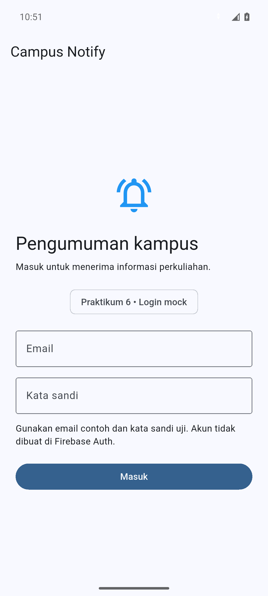
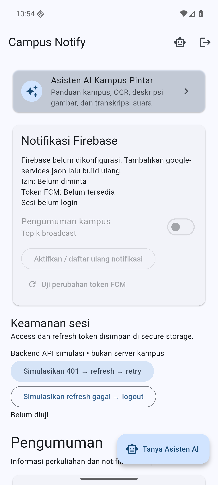

# Minggu 13: CI/CD dan Otomatisasi

Campus Notify dari Minggu 12 diotomatiskan menggunakan pipeline GitHub Actions sesuai [codelab Minggu 13](https://jti-polinema.github.io/flutter-codelab/13-minggu-13-ci-cd-automation/index.html#0). Proyek Minggu 12 disalin apa adanya pada commit snapshot `d9c5e20` ke `13-week-13-ci-cd-automation/`, lalu dipasangkan workflow CI di [`.github/workflows/flutter-ci.yml`](../.github/workflows/flutter-ci.yml) untuk menjalankan pemeriksaan format, analisis statis ketat (`--fatal-infos`), unit/widget test dengan coverage, serta membangun dan menyimpan artefak **APK** dan **AAB** rilis.

Pipeline dijalankan secara nyata melalui **Pull Request #3** dan **push ke `main`**. Sebelum merge, CI secara otomatis menangkap dua masalah kompatibilitas lingkungan bersih (import berkas `firebase_options.dart` yang di-gitignore dan deprecasi `package:flutter/material.dart` di Flutter 3.50) serta persyaratan minimal AGP 9.1.1 / Gradle 9.5.0. Perilaku gagal saat test bermasalah juga dibuktikan langsung di GitHub Actions sebelum seluruh pipeline menjadi hijau, di-merge ke `main`, ditandai tag `v1.1.0`, dan artefak APK rilis hasil CI diuji langsung pada emulator Android.

## Identitas Mahasiswa

- Nama: Agus Prasetyo
- NIM: 244107020049
- Kelas: TI-3H
- Mata Kuliah: Pemrograman Mobile
- Program Studi: D4 Teknik Informatika
- Jurusan: Teknologi Informasi

## Tujuan Pembelajaran

- Menjelaskan alur CI/CD dari commit hingga artefak aplikasi
- Membuat workflow GitHub Actions untuk format, analisis statis, pengujian, dan build Android
- Menyimpan APK dan AAB sebagai artefak yang dapat ditinjau dan diunduh
- Menerapkan semantic versioning, Git tag, dan memahami batasan penyimpanan secret

## Persiapan

- **Lingkungan lokal:** Flutter 3.50.1 (stable), Dart 3.14.0, OpenJDK 21.0.13, Android SDK Platform 36, Build-Tools 36.0.0.
- **Lingkungan runner CI:** GitHub Actions `ubuntu-latest`, `actions/setup-java@v5` (Temurin JDK 21), `subosito/flutter-action@v2` (`channel: stable`, `cache: true`, resolves Flutter 3.50.1).
- **Perangkat uji artefak CI:** Emulator `Pixel_API36` (`emulator-5554`, Android 16 / API 36, `google_apis;x86_64`).
- **Adaptasi monorepo:** GitHub Actions hanya membaca workflow dari direktori `.github/workflows/` di root repository. Karena proyek Minggu 13 berada di subdirektori `13-week-13-ci-cd-automation/`, workflow [`.github/workflows/flutter-ci.yml`](../.github/workflows/flutter-ci.yml) mengatur `defaults.run.working-directory: 13-week-13-ci-cd-automation` dan mengunggah artefak dari jalur relatif terhadap root repository.

## Pemetaan Langkah Codelab

| Langkah codelab | Penerapan di Campus Notify |
| --- | --- |
| 1. Memahami CI/CD, event, dan permission | Workflow dipicu pada `pull_request` (sebelum merge), `push` ke `main`, dan `workflow_dispatch`. Permission dibatasi minimum (`contents: read`) dengan `concurrency` untuk membatalkan run lama pada ref yang sama |
| 2. Workflow CI Flutter & cek lokal | `.github/workflows/flutter-ci.yml` menjalankan `flutter pub get`, `dart format --output=none --set-exit-if-changed .`, `flutter analyze --fatal-infos`, dan `flutter test --coverage` |
| 3. Membangun & menyimpan APK/AAB | Langkah `flutter build apk --release`, `flutter build appbundle --release`, dan `actions/upload-artifact@v4` (`name: android-builds`, `if-no-files-found: error`, `retention-days: 7`) |
| 4. Versioning, secrets, dan keamanan | Versi dinaikkan dari `1.0.0+1` ke `1.1.0+2` di `pubspec.yaml`, ditandai tag beranotasi `v1.1.0` pada commit hijau `ad3c9f7`; berkas konfigurasi lokal (`google-services.json`, `.env`) tetap di-gitignore dan tidak diganti nilai palsu |
| 5. Menjalankan & mengevaluasi pipeline | Diverifikasi lewat [PR #3](https://github.com/404GH0ST/244107020049-mobile-course/pull/3) (kegagalan analyze, kegagalan test, kegagalan AGP, lalu hijau penuh) dan push ke `main` (run `45648827206`), dilanjutkan unduh artefak serta smoke test APK di emulator |

## Pemeriksaan yang Dijalankan Workflow

Alur di [`.github/workflows/flutter-ci.yml`](../.github/workflows/flutter-ci.yml) menjalankan satu job `test-and-build` secara berurutan (fail-fast: langkah berikutnya otomatis dilewati jika ada langkah gagal):

1. **Checkout & Toolchain (`actions/checkout@v4`, `actions/setup-java@v5`, `subosito/flutter-action@v2`):** Mengambil kode sumber dan menyiapkan JDK 21 serta Flutter `stable` dengan cache aktif.
2. **Resolusi dependensi (`flutter pub get`):** Memastikan `pubspec.yaml` dan `pubspec.lock` terselesaikan pada runner bersih.
3. **Pemeriksaan format (`dart format --output=none --set-exit-if-changed .`):** Menolak kode yang belum terformat standar Dart.
4. **Analisis statis ketat (`flutter analyze --fatal-infos`):** Menggagalkan build tidak hanya pada error/warning, tetapi juga pada lint atau deprecation info.
5. **Pengujian otomatis (`flutter test --coverage`):** Menjalankan seluruh 85 unit & widget test dan menghasilkan `coverage/lcov.info`.
6. **Build rilis Android (`flutter build apk --release` & `flutter build appbundle --release`):** Hanya berjalan setelah format, analisis, dan seluruh test lulus.
7. **Unggah artefak (`actions/upload-artifact@v4`):** Menyimpan `app-release.apk` dan `app-release.aab` ke bundel `android-builds` selama 7 hari; gagal otomatis jika berkas tidak ditemukan (`if-no-files-found: error`).

## Praktikum

### Riwayat Eksekusi Pipeline dan Bukti Kegagalan (Langkah 5)

Seluruh riwayat eksekusi tercatat langsung di tab **Actions** pada [PR #3](https://github.com/404GH0ST/244107020049-mobile-course/pull/3) dan branch `main`:

| # | Run ID | Event | Commit | Hasil | Step Berhenti / Catatan |
| --- | --- | --- | --- | --- | --- |
| 1 | [`45645949403`](https://github.com/404GH0ST/244107020049-mobile-course/actions/runs/45645949403) | `pull_request` (#3) | `f6fb101` | Gagal | Gagal di `flutter analyze --fatal-infos` (21 isu: 4 error import `firebase_options.dart` yang di-gitignore + 17 info deprecasi `package:flutter/material.dart`). Test & build dilewati |
| 2 | [`45646390911`](https://github.com/404GH0ST/244107020049-mobile-course/actions/runs/45646390911) | `pull_request` (#3) | `7021c19` *(uji sementara)* | Gagal | Lolos format & analyze, lalu gagal di `flutter test --coverage` (`84 tests passed, 1 failed`). Build APK/AAB & upload artefak otomatis dilewati |
| 3 | [`45646848956`](https://github.com/404GH0ST/244107020049-mobile-course/actions/runs/45646848956) | `pull_request` (#3) | `372f172` | Gagal | Lolos format, analyze, & 85 test, lalu gagal di `flutter build apk --release` karena AGP `9.1.0` di bawah batas minimum Flutter 3.50 (`9.1.1`) |
| 4 | [`45647494313`](https://github.com/404GH0ST/244107020049-mobile-course/actions/runs/45647494313) | `pull_request` (#3) | `3b202c1` | **Sukses** | Seluruh 11 step lulus (±8 menit 26 detik), artefak `android-builds` terunggah |
| 5 | [`45648827206`](https://github.com/404GH0ST/244107020049-mobile-course/actions/runs/45648827206) | `push` (`main`) | `ad3c9f7` (`v1.1.0`) | **Sukses** | Merge commit PR #3 lulus penuh (±7 menit 01 detik), artefak `android-builds` terunggah |

Ringkasan perbaikan nyata yang dipicu oleh CI sebelum merge:

1. **Decouple `firebase_options.dart` (commit `910c310`):** Pada Minggu 6–12, `lib/firebase_options.dart` di-gitignore sehingga hanya ada di mesin lokal. Di runner CI yang bersih, `lib/main.dart` dan `lib/features/push/data/services/push_service.dart` gagal kompilasi (`uri_does_not_exist`). Keduanya diubah memakai `Firebase.initializeApp()` tanpa import langsung berkas gitignored tersebut: saat `google-services.json` tersedia ia membaca konfigurasi native Android, dan saat tidak tersedia di CI ia masuk ke blok `catch` secara aman ke mode login mock.
2. **Migrasi `package:material_ui/material_ui.dart` (commit `910c310`):** Flutter 3.50 menandai `package:flutter/material.dart` deprecated (`deprecated_member_use`). Karena workflow memakai `--fatal-infos`, 17 berkas di `lib/`, `test/`, dan `integration_test/` gagal analisis. Dependensi langsung `material_ui: ^1.1.0` ditambahkan dan seluruh 17 import dimigrasikan.
3. **Upgrade AGP & Gradle + `setup-java@v5` (commit `372f172` & `3b202c1`):** AGP dinaikkan dari `9.1.0` ke `9.3.1` dan Gradle Wrapper dari `9.3.1` ke `9.5.0` sesuai persyaratan Flutter 3.50, serta action Java diperbarui ke `actions/setup-java@v5`.
4. **Verifikasi fail-fast saat test gagal (run `45646390911`):** Satu assertion pada `test/login_validation_test.dart` sempat dipatahkan sementara pada branch PR untuk membuktikan `flutter test --coverage` menghentikan job sebelum langkah build Android berjalan, lalu commit sementara tersebut dihapus sebelum merge agar riwayat `main` tetap bersih.

Cuplikan ringkas kegagalan test pada run `45646390911`:

```text
✓ Run dart format --output=none --set-exit-if-changed .
✓ Run flutter analyze --fatal-infos
X Run flutter test --coverage   -> 84 tests passed, 1 failed. (exit code 1)
- Run flutter build apk --release       (skipped)
- Run flutter build appbundle --release (skipped)
- Run actions/upload-artifact@v4        (skipped)
```

### Verifikasi Artefak `android-builds` dan Smoke Test Emulator

Artefak dari run `main` [`45648827206`](https://github.com/404GH0ST/244107020049-mobile-course/actions/runs/45648827206) (commit `ad3c9f7`, tag `v1.1.0`) diunduh menggunakan `gh run download 45648827206 -n android-builds`:

| Berkas Artefak | Ukuran | SHA-256 | Metadata Terverifikasi |
| --- | --- | --- | --- |
| `flutter-apk/app-release.apk` | 54.007.130 byte (51,5 MiB) | `1d0ed066ad3cd85ec024254b01993e7a46e99b2075112d0f757c203559d1d22b` | `id.ac.polinema.campus_notify`, `versionName=1.1.0`, `versionCode=2`, `targetSdk=36`, ABI `arm64-v8a`/`armeabi-v7a`/`x86_64`, signer `CN=Android Debug` |
| `bundle/release/app-release.aab` | 53.858.261 byte (51,4 MiB) | `a25ea2055b3be3ae5febfd03bdb4aefb2d739810cc74abfcbcc402a927020cad` | `id.ac.polinema.campus_notify`, `versionName=1.1.0`, `versionCode=2`, AGP `9.3.1`, R8 `9.3.16` full-mode (shrinking 88,13%, obfuscation 88,13%) |

APK rilis hasil CI kemudian dipasang dan dijalankan langsung pada emulator `Pixel_API36` (`adb install -r app-release.apk`) untuk memastikan build R8 tanpa `google-services.json` tetap berjalan stabil tanpa crash:

| Layar Login (APK Rilis CI) | Beranda Setelah Login (APK Rilis CI) |
| --- | --- |
|  |  |

Log runtime pada emulator mengonfirmasi fallback Firebase bekerja sesuai rancangan:

```text
I flutter : [FCM] Firebase belum dikonfigurasi; login mock tetap tersedia.
```

## Versioning dan Rencana Versi Berikutnya

- **Versi rilis saat ini:** `1.1.0+2` di `pubspec.yaml` (naik dari `1.0.0+1` pada Minggu 12: minor naik karena penambahan otomasi CI/CD dan migrasi `material_ui`, build number naik dari `1` ke `2`).
- **Git tag terkait:** `v1.1.0` menunjuk ke commit hijau `ad3c9f7` yang menghasilkan run [`45648827206`](https://github.com/404GH0ST/244107020049-mobile-course/actions/runs/45648827206) dan artefak `android-builds`.

Rencana penomoran versi berikutnya mengikuti [Semantic Versioning](https://semver.org/):

| Target Versi (`pubspec.yaml`) | Tag Git | Kapan Digunakan |
| --- | --- | --- |
| `1.1.1+3` | `v1.1.1` | Perbaikan bug kecil (patch), misalnya update action Node.js 24 atau perbaikan UI minor tanpa perubahan fitur |
| `1.2.0+4` | `v1.2.0` | Penambahan fitur kompatibel (minor), misalnya workflow rilis terpisah untuk signing keystore produksi & injeksi `google-services.json` dari GitHub Secrets |
| `2.0.0+5` | `v2.0.0` | Perubahan tidak kompatibel (major), misalnya penggantian backend mock ke REST API kampus produksi dan skema autentikasi baru |

Setiap unggahan baru ke jalur internal testing atau Google Play wajib menaikkan `versionCode` (`+3`, `+4`, `+5`, dst.) meskipun perubahan hanya berupa patch atau hotfix.

## Keamanan, Secrets, dan Risiko yang Masih Perlu Ditangani

| Aspek | Kondisi Saat Ini | Risiko | Mitigasi yang Diperlukan Sebelum Rilis Publik |
| --- | --- | --- | --- |
| **Android Release Signing** | `build.gradle.kts` masih memakai `signingConfigs.getByName("debug")` (`CN=Android Debug`) | APK/AAB ditolak Google Play Store dan tidak dapat menjadi rilis produksi resmi | Buat keystore produksi lokal, simpan base64 keystore + password + alias di **GitHub Actions Secrets**, dan injeksikan hanya pada workflow rilis terpisah yang dipicu tag `v*` (bukan pada `pull_request`) |
| **Konfigurasi Firebase (`google-services.json`)** | Di-gitignore; tidak ada di runner CI sehingga FCM nonaktif di build CI | Build CI tidak dapat menerima push notification FCM secara nyata | Simpan konfigurasi environment produksi/staging terpisah dan injeksikan lewat workflow rilis terkontrol (atau Environment Secrets dengan manual approval) |
| **API Key & `--dart-define`** | Tidak ada secret yang di-commit; API key Gemini dimasukkan pengguna saat runtime ke secure storage | Jika suatu saat secret diteruskan lewat `--dart-define`, nilainya tetap dapat diekstrak dari APK | Gunakan `--dart-define` hanya untuk konfigurasi publik (URL API, nama environment); rahasia server/AI sebaiknya ditaruh di backend proxy |
| **Proteksi Branch & PR Fork** | Workflow sudah memakai `permissions: contents: read`, namun branch protection `main` belum dikunci wajib status check & review | Commit langsung ke `main` masih memungkinkan melewati PR | Aktifkan GitHub Branch Protection pada `main` dengan *Require status checks to pass* (`test-and-build`) dan minimal 1 approval |
| **Supply Chain Actions** | Action masih di-pin ke tag mayor (`@v4`, `@v5`, `@v2`); runner menampilkan peringatan deprecasi Node.js 20 untuk `checkout@v4` dan `upload-artifact@v4` | Tag mayor bisa bergeser; runtime Node.js 20 akan dihentikan GitHub | Upgrade ke rilis Node.js 24 (`actions/checkout@v5+`, `actions/upload-artifact@v5+`) dan pin ke full commit SHA untuk workflow rilis produksi |

## Bukti Mesin Hijau

Pemeriksaan pada 25 November 2026 (commit `ad3c9f7`, tag `v1.1.0`):

| Pemeriksaan | Lingkungan | Hasil |
| --- | --- | --- |
| `dart format --output=none --set-exit-if-changed .` | Lokal & CI (`45648827206`) | 70 berkas, 0 perubahan |
| `flutter analyze --fatal-infos` | Lokal & CI (`45648827206`) | No issues found |
| `flutter test --coverage` | Lokal & CI (`45648827206`) | 85 test lulus, coverage 69,0% (`861/1247` baris) |
| `flutter build apk --release` | CI (`45648827206`) | Sukses (`app-release.apk`, 51,5 MiB) |
| `flutter build appbundle --release` | CI (`45648827206`) | Sukses (`app-release.aab`, 51,4 MiB) |
| `actions/upload-artifact@v4` | CI (`45648827206`) | Artefak `android-builds` terunggah & terunduh utuh |
| Smoke test APK rilis CI | Emulator `Pixel_API36` (Android 16) | Terpasang, login mock → beranda berjalan tanpa crash |

## Cara Menjalankan

Pemeriksaan lokal sebelum push:

```bash
cd 13-week-13-ci-cd-automation
flutter pub get
dart format --output=none --set-exit-if-changed .
flutter analyze --fatal-infos
flutter test --coverage
flutter build apk --release
flutter build appbundle --release
```

Memantau workflow dan mengunduh artefak dari GitHub Actions:

```bash
gh run list --workflow flutter-ci.yml -L 5
gh run view 45648827206
gh run download 45648827206 -n android-builds -D /tmp/android-builds
```

Struktur hasil pengerjaan:

```text
.github/workflows/flutter-ci.yml                 (workflow CI/CD GitHub Actions)
13-week-13-ci-cd-automation/
  pubspec.yaml                                   (version: 1.1.0+2, material_ui: ^1.1.0)
  android/settings.gradle.kts                    (AGP 9.3.1)
  android/gradle/wrapper/gradle-wrapper.properties (Gradle 9.5.0)
  lib/main.dart                                  (inisialisasi Firebase tanpa import gitignored)
  lib/features/push/data/services/push_service.dart
  screenshots/
    ci_release_login.png
    ci_release_home.png
  README.md
```

## Refleksi Praktikum

1. **Masalah apa yang ditemukan otomatis sebelum perubahan di-merge?**
   Tiga masalah nyata tertangkap sebelum PR #3 di-merge ke `main`: pertama, ketergantungan tersembunyi pada berkas lokal `lib/firebase_options.dart` yang di-gitignore ("jalan di lokal, rusak di runner bersih"); kedua, 17 peringatan deprecasi `package:flutter/material.dart` yang langsung gagal di bawah `flutter analyze --fatal-infos` pada Flutter 3.50; ketiga, versi AGP `9.1.0` dan Gradle `9.3.1` yang tidak lagi memenuhi syarat minimal build rilis Flutter 3.50. Selain itu, uji kegagalan pada run `45646390911` memastikan 1 test gagal langsung memblokir build APK/AAB.
2. **Informasi apa yang Anda butuhkan untuk menyelidiki build yang gagal?**
   Run ID dan URL job, commit SHA pemicu (`headSha`), daftar step beserta status (`success`/`failure`/`skipped`), log lengkap step yang gagal (beserta exit code dan stack trace), serta versi toolchain pada runner (versi Flutter, Dart, JDK, AGP, Gradle). Informasi tersebut memungkinkan kita mereproduksi kegagalan secara persis di lokal sebelum mendorong perbaikan.
3. **Bagian mana yang masih perlu persetujuan atau pemeriksaan manual sebelum rilis?**
   Konfigurasi signing produksi (keystore & verifikasi sertifikat non-debug), pengecekan izin Android di `AndroidManifest.xml` serta kebijakan privasi, verifikasi integrasi layanan nyata (`google-services.json`/FCM dan backend asli), pengujian manual pada perangkat fisik untuk alur kritikal, pemeriksaan catatan rilis serta kesesuaian `versionName`/`versionCode`, dan persetujuan rilis (manual approval) sebelum unggah ke Google Play Console.

## Referensi Pendukung

- [Modul Minggu 13 JTI Polinema: CI/CD dan Otomatisasi](https://jti-polinema.github.io/flutter-codelab/13-minggu-13-ci-cd-automation/index.html#0)
- [GitHub Actions documentation](https://docs.github.com/actions)
- [Continuous delivery with Flutter](https://docs.flutter.dev/deployment/cd)
- [Build and release an Android app](https://docs.flutter.dev/deployment/android)
- [Using secrets in GitHub Actions](https://docs.github.com/en/actions/security-guides/using-secrets-in-github-actions)
- [Semantic Versioning](https://semver.org/)
